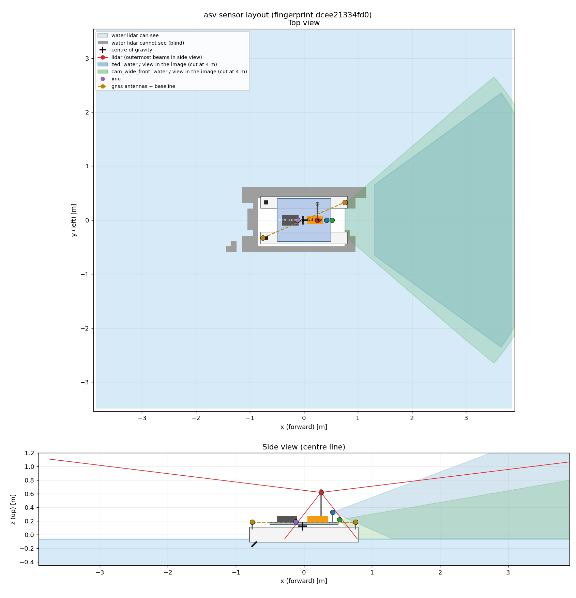

# RoboBoat ASV simulation · GNSS-aided EKF-SLAM

Simulation environment for the **BME Solar Boat Team**'s RoboBoat autonomous
surface vehicle (ASV), built for a bachelor's thesis on GNSS-aided EKF-SLAM:
map the course buoys by colour, localise the boat, and measure how accurate and
how consistent both are against ground truth under different sensor noise levels.


> **Thesis source:** [kmarcell0/thesis-latex](https://github.com/kmarcell0/thesis-latex)

---

## What this repository aims to do

- **Simulate** the boat, the water and the RoboBoat 2026 course in Gazebo + VRX
  (waves, buoyancy, drag), with every sensor of the real boat.
- **Separate truth from measurement:** Gazebo gives perfect sensor data and the
  true pose; our own *corruptor* adds noise, biases, GNSS fix modes and outages,
  all seeded and set from one file.
- **Estimate:** an EKF-SLAM filter fuses GNSS position and velocity, the
  dual-antenna heading, the gyro and buoy detections (range, bearing, colour) to
  estimate the boat's pose and the buoy map.
- **Evaluate:** compare the estimate with ground truth: position and heading
  error, map error, and filter consistency (NEES / NIS).
- **Sweep:** record each trajectory once, then replay it through corruptor →
  detector → filter for many noise levels and seeds, so every setting sees the
  same motion and results repeat exactly.
- **Stay deployable:** the filter, perception and guidance code is plain C++17
  with ROS-free cores, so it can later run on the boat's onboard computer.

## The boat

<p align="center">
  
</p>

| Part | In the simulation |
|---|---|
| Hull | Catamaran, 2 × 1.60 m cylindrical hulls, 0.66 m apart; 18.2 kg in total |
| Propulsion | 2 steerable (azimuth) thrusters, +50 / −40 N, ±90° pod angle |
| Lidar | Livox Mid-360, mounted upside down, 10 Hz |
| Stereo camera | Stereolabs ZED 2i (4 mm lens) |
| Wide camera | Arducam AR0234, tilted 20° down |
| IMU | Pixhawk 6X |
| GNSS | Unicore UM982 dual-antenna RTK (position + heading), 1.66 m baseline |

All numbers come from [`asv.yaml`](ws/src/asv_sim/config/asv.yaml), the single
source of truth for the model; the Gazebo model, the bridge and the TF frames are
generated from it ([how](ws/src/asv_sim/docs/HOW_IT_WORKS.md)).

## How it fits together

```
 Gazebo + VRX  (perfect sensors, true pose)
   │ ros_gz_bridge
   ├──► /asv/ground_truth/odom ─────┬──────────────────────────────┐
   │                                │                              │
   ▼ /asv/{imu,gnss,lidar}/...      ▼                              │
 corruptor                   fake detector                         │
 (noise, biases, GNSS        (ground truth + true buoy map,        │
  modes and outages,          controlled noise, true colour)       │
  dual-antenna heading)             │                              │
   │ /asv/sensors/...               │ /asv/perception/buoys        │
   │                                ▼                              ▼
   └─────────────────────────► EKF-SLAM ──► /asv/slam/... ──► evaluation
                                    │                       (errors, NEES)
                                    ▼
                              RViz (live view)
```

The thesis numbers come from the offline path: a Gazebo run is recorded once as
a rosbag; `slam_replay` then runs corruptor → detector → filter over it for each
setting. Details: [`docs/design.md`](docs/design.md).

## Status

```
M0 🟩🟩🟩🟩🟨 │ M1 🟩🟩⬜⬜⬜⬜⬜⬜⬜ │ M2 ⬜⬜⬜⬜⬜⬜⬜⬜ │ M3 ⬜⬜⬜⬜⬜⬜⬜⬜⬜ │ M4 ⬜ │ M6 ⬜⬜⬜
```

| Milestone | What | State |
|---|---|---|
| M0 | Housekeeping: docs, simulation time, toolchain, repository | in progress |
| M1 | Drive the course on ground truth (guidance, waypoint follower, teleop) | started |
| M2 | From perfect to realistic sensor data (geodesy, corruptor, buoy map) | planned |
| M3 | The EKF-SLAM filter, offline (detector, filter, replay, evaluation) | planned |
| M4 | Live filter and RViz view | planned |
| M5 | Real lidar + camera perception | optional |
| M6 | Experiments: noise sweeps, GNSS outages, waves | planned |

The step-by-step plan, with every decision and its reason, is in
[`docs/master_plan.md`](docs/master_plan.md).

## Quick start

Needs Docker with Compose and a GPU usable through `/dev/dri` (for the Gazebo
window and the camera sensors). Developed on NixOS; any Linux host should work.

```bash
# 1. Clone, including VRX (pinned submodule)
git clone --recurse-submodules https://github.com/kmarcell0/thesis-docker-sim.git
cd thesis-docker-sim            # already cloned? git submodule update --init

# 2. Write .env with your user, video and render group IDs, then start the container
./setup-env.sh
docker compose up -d

# 3. Build our package and what it needs (not all of VRX)
docker compose exec -T sim bash -ic "cd /ws && colcon build --symlink-install --packages-up-to asv_sim"

# 4. Tests
docker compose exec -T sim bash -ic "cd /ws/src/asv_sim && python3 -m unittest discover -s tests"
```

Run the simulation:

```bash
# with the Gazebo window (if it does not open, allow X access on the host: xhost +local:)
docker compose exec sim bash -ic "ros2 launch asv_sim sim.launch.py"

# headless, in the background
docker compose exec -d sim bash -ic "ros2 launch asv_sim sim.launch.py gui:=false > /tmp/sim.log 2>&1"
docker compose exec -T sim bash -ic "timeout 10 ros2 topic hz /asv/ground_truth/odom"

# stop
docker compose exec -T sim bash -ic "pkill -f 'ros2 launch'; pkill -f 'gz sim'; pkill -f parameter_bridge"
```

Useful checks with the simulation running:

```bash
docker compose exec -T sim bash -ic "cd /ws/src/asv_sim && python3 tools/actuator_check.py"   # drag model, steering sign
docker compose exec -T sim bash -ic "cd /ws/src/asv_sim && python3 tools/sim_time_check.py"   # timers follow simulation time
```

After editing `asv.yaml`, regenerate the model:
`docker compose exec -T sim bash -ic "cd /ws/src/asv_sim && python3 tools/make_asv.py"`.

## Repository layout

```
docs/                    master plan, design reference, glossary, step logs
docker/Dockerfile        container image (ROS 2 Jazzy + Gazebo Harmonic)
compose.yaml             container setup (GPU, X11, workspace mount)
setup-env.sh             writes .env for compose.yaml
ws/                      colcon workspace, mounted at /ws in the container
  src/vrx/               VRX (git submodule, osrf/vrx @ 7609d1b)
  src/asv_sim/           our simulator package
    config/asv.yaml      boat description (edit this)
    models/, worlds/     generated boat model, RoboBoat 2026 course
    launch/              sim.launch.py
    tools/               model generator, studies, checks
    tests/               Python tests
  data/                  bags, run results, figures (not in git)
```

Planned packages (`asv_core`, `asv_msgs`, `asv_slam`, `asv_eval`, ...) are
listed in [`docs/design.md`](docs/design.md) §12.

## Documentation

| File | What is in it |
|---|---|
| [`docs/master_plan.md`](docs/master_plan.md) | What gets built and in which order; all decisions |
| [`docs/design.md`](docs/design.md) | Topics, frames, time rules, noise models, filter, evaluation |
| [`docs/glossary.md`](docs/glossary.md) | Symbols and plain-language terms |
| [`docs/decision_notes.md`](docs/decision_notes.md) | Background for the decisions still open |
| [`docs/plans/`](docs/plans/) | Brief and report of every finished step |
| [`ws/src/asv_sim/docs/HOW_IT_WORKS.md`](ws/src/asv_sim/docs/HOW_IT_WORKS.md) | How the boat model generator works |
| [`CLAUDE.md`](CLAUDE.md) | Working rules for the AI coding assistant used in this project |

## Related

- **Thesis (LaTeX source):** <https://github.com/kmarcell0/thesis-latex>
- **VRX** (Virtual RobotX; water, waves, buoyancy, course models):
  <https://github.com/osrf/vrx>, pinned at commit `7609d1b`
- **BME Solar Boat Team**, Budapest University of Technology and Economics
