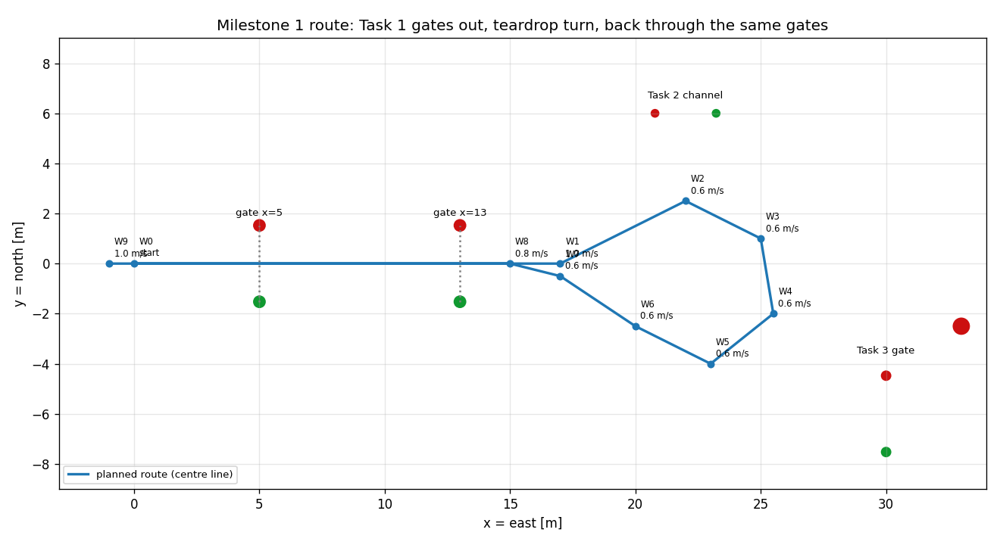

# Milestone 1 autonomy — as built (M1.8)

Reference notes for the Milestone 1 drivers (waypoint follower §1–8, maneuver
player §9, keyboard teleop §10): what runs, the final equations, the
parameters and the measured results. Bullet notes and
equations only.

- **Status of this file:** the as-built state after M1.8 (2026-10-20).
- **History and reasons:** `milestone1_plan.md` §2–6 (first proposal) and §10
  (decisions 10.1–10.16); decision labels below ("10.13 a") point there.
- **Symbols:** `docs/glossary.md`, Symbols table. The guidance symbols
  (W_i, ℓ_i, γ_i, s, e, Δ, R_switch, p_LOS, d_end, ψ_d, ψ̃, χ, u_min, K_ψ, K_ω,
  ψ_spin, K_spin, K_s, ψ_turn, u_cmd, u_ref) are still **proposed**.
- **Source tags:** [DS] datasheet, [EST] estimate, [REPO] this repository,
  [MEASURED] measured in a run here.

---

## 1. Run it

```bash
# from ~/thesis/docker-sym, container up (docker compose up -d), asv_sim built
docker compose exec sim bash -ic "ros2 launch asv_sim task1.launch.py"              # with the Gazebo window
docker compose exec -d sim bash -ic "ros2 launch asv_sim task1.launch.py gui:=false > /tmp/task1.log 2>&1"
docker compose exec -T sim bash -ic "timeout 90 ros2 topic echo /asv/autonomy/status"   # watch the states
```

- Starts Gazebo (`sim.launch.py`) and the `waypoint_follower` node; all nodes on
  `use_sim_time`.
- Other route or gains: `params_file:=<path>` (default `config/task1_route.yaml`).
- Stays up after FINISHED (thrust held at 0); stop with Ctrl-C or the `pkill`
  line in `README.md`.
- Record and analyse a run (§7).

## 2. Route



| Waypoint | x [m] | y [m] | u_ref towards it [m/s] | Role |
|---|---|---|---|---|
| W0 | 0 | 0 | – | start = spawn, fixed in the file (10.15 a) |
| W1 | 17 | 0 | 1.0 | out through gate 1 (x = 5) and gate 2 (x = 13) |
| W2 | 22 | 2.5 | 0.6 | set up the turn |
| W3 | 25 | 1 | 0.6 | teardrop turn, clockwise |
| W4 | 25.5 | −2 | 0.6 | |
| W5 | 23 | −4 | 0.6 | |
| W6 | 20 | −2.5 | 0.6 | |
| W7 | 17 | −0.5 | 0.6 | back to the centre line |
| W8 | 15 | 0 | 0.8 | aligned 2 m before gate 2 |
| W9 | −1 | 0 | 1.0 | back through both gates, stop |

- n_w = 9 segments, 57 m in total [REPO `task1_route.yaml`].
- Gates: red buoy at y = +1.524 m, green at y = −1.524 m, at x = 5 and 13 m;
  Sur-Mark radius r = 0.2286 m [REPO `models/rb26_surmark_red/model.sdf`].
- The turn goes between the Task 2 channel (y ≥ 6 m) and the Task 3 gate
  (x = 30 m).

## 3. Architecture

```
 /asv/ground_truth/odom ──► waypoint_follower (node, I/O only, 20 Hz ROS-clock timer)
                                 │
                                 ▼  asv_sim::Follower::step()        (follower.hpp)
          Route ──► LosGuidance ──► course_angle() ──► HeadingControl ─┐
            │ e, d_end                                  steer, spin    ├─► mix() ──► 4 thruster commands
            └────────────────────► SpeedControl ──── throttle ─────────┘
          GateMonitor (every new odometry pose): gate events, clearances
```

- ROS-free library `asv_sim_guidance` (`include/asv_sim/`, `src/`), unit
  tested (gtests in `test/`); the node `src/waypoint_follower.cpp` only
  converts messages.
- `test_closed_loop` drives the same `Follower` on a 3-DOF boat model
  (`test/boat_model.hpp`), without Gazebo.
- Boat values (X_u, X_uu, T_max, T_min, steer limit, L, b_w) are read from
  `config/asv.yaml` by `launch/task1.launch.py` (`boat_params()`), never
  typed into `task1_route.yaml`.

| Direction | Topic | Type | Content |
|---|---|---|---|
| in | `/asv/ground_truth/odom` (`odom_topic`) | nav_msgs/Odometry | pose in world (ENU), twist in body frame |
| out | `/asv/thrusters/{left,right}/thrust` | std_msgs/Float64 | N |
| out | `/asv/thrusters/{left,right}/pos` | std_msgs/Float64 | pod angle δ, rad |
| out | `/asv/autonomy/path` | nav_msgs/Path | the route, latched (transient local) |
| out | `/asv/autonomy/target` | geometry_msgs/PointStamped | p_LOS |
| out | `/asv/autonomy/status` | std_msgs/String | `WAITING`, `RUNNING i/9`, `FINISHED`, `STOPPED: <reason>`, `GATE ...` lines |
| out | `/asv/autonomy/cross_track_error` | std_msgs/Float64 | e, m |

## 4. Inputs from the odometry

- p = (x, y): pose position, world frame.
- ψ = atan2(2(q_w q_z + q_x q_y), 1 − 2(q_y² + q_z²)) — `yaw_from_quaternion()`
  (`angles.hpp`).
- u = twist.linear.x, v = twist.linear.y, ω = twist.angular.z (body frame).
- Every angle difference: wrap to (−π, π] — `wrap_angle()` (`angles.hpp`).
- Time step Δt from consecutive odometry stamps, not from 1/control_rate.

## 5. Equations, final form

### 5.1 Route progression — `Route::update()` (`guidance.hpp`)

- Segment i: W_i → W_{i+1}, direction γ_i = atan2(W_{i+1,y} − W_{i,y}, W_{i+1,x} − W_{i,x}), length ℓ_i.

$$\hat t = (\cos\gamma_i, \sin\gamma_i),\quad \hat n = (-\sin\gamma_i, \cos\gamma_i),\qquad
s = (\mathbf p - W_i)\cdot\hat t,\quad e = (\mathbf p - W_i)\cdot\hat n$$

- e > 0: boat left of the path.
- Switch to segment i+1 when s ≥ ℓ_i − R_switch; at most one switch per step.
  After a switch, s and e are measured again on the new segment, so LOS and
  d_end in the same step use the new segment (M1.9).
  On the last segment the same test sets FINISHED (10.7 a).
- Distance left along the route — `Route::remaining_distance()`:

$$d_\text{end} = (\ell_i - s) + \sum_{j>i} \ell_j$$

### 5.2 Line-of-sight guidance — `LosGuidance::compute()` (`guidance.hpp`)

- p_LOS: walk Δ along the route from the projection W_i + s t̂; what is left
  past W_{i+1} carries onto the next segments; never past W_{n_w} (10.6 a).

$$\psi_d = \operatorname{atan2}\big(p_{\text{LOS},y} - y,\ p_{\text{LOS},x} - x\big)$$

- On a straight segment this equals ψ_d = γ_i + atan2(−e, Δ) (Fossen's LOS).

### 5.3 Course — `course_angle()` (`control.hpp`)

$$\chi = \operatorname{wrap}\big(\psi + \operatorname{atan2}(v,\ \max(u, u_\text{min}))\big)$$

- The error is taken against where the boat moves, not where it points
  (10.13 a: removes crabbing on straight legs).
- max(u, u_min): low-speed guard; near u = 0 the sideslip angle is meaningless.

### 5.4 Heading control — `HeadingControl::compute()` (`control.hpp`)

$$\tilde\psi = \operatorname{wrap}(\psi_d - \chi)$$

$$\text{steer} = \operatorname{clamp}\big(K_\psi\,\tilde\psi - K_\omega\,\omega,\ \pm\text{max\_steer}\big)$$

$$\text{spin} = \operatorname{clamp}\Big(K_s\,\tilde\psi + \operatorname{sign}(\tilde\psi)\,\operatorname{clamp}\big(K_\text{spin}(|\tilde\psi| - \psi_\text{spin}),\ 0,\ \text{spin\_max}\big),\ \pm\text{spin\_max}\Big)$$

- D term on the measured yaw rate ω: no kick when ψ_d jumps at a switch.
- K_s ψ̃ (10.16 b): differential thrust at every error size; turns the boat
  without the sideways push of the aft pods; damps the cross-track swing.
- Ramp from ψ_spin (10.3 b, 10.14 a): extra spin for sharp turns, no jump at
  the threshold.
- Signs: steer > 0 and spin > 0 turn the boat left, **while the thrust is
  forward** (10.2).

### 5.5 Speed control — `SpeedControl` (`control.hpp`)

- Commanded speed — `commanded_speed()`:

$$u_\text{cmd} = \max\Big(0,\ \min\big(u_\text{ref}\,\max(0, \cos\tilde\psi),\ K_\text{stop}\, d_\text{end}\big)\Big)$$

- Throttle (fraction of T_max) — `update()`, feedforward `feedforward_throttle()`:

$$T_\text{ff}(u) = X_u u + X_{uu} u|u|,\qquad
\text{throttle} = \operatorname{clamp}\Big(\frac{T_\text{ff}(u_\text{cmd})}{2T_\text{max}} + K_P(u_\text{cmd} - u) + K_I I,\ \text{lower},\ \text{max\_throttle}\Big)$$

- lower = 0 while |ψ̃| > ψ_turn, else min_throttle (10.2 c: pods push forward
  in a turn, so the steering sign holds).
- Anti-windup (conditional integration): I += (u_cmd − u) Δt, unless the
  output is at a limit and the error pushes further into it.
- Example: 1.0 m/s needs T_ff = 4 + 6 = 10 N, throttle 0.1 at T_max = 50 N.
- X_u, X_uu are Gazebo's own drag values: fine for a feedforward, never inside
  the filter (inverse crime).

### 5.6 Allocation — `mix()` (`mix.hpp`)

$$T_L^* = T_\text{max}(\text{throttle} - \text{spin}),\qquad T_R^* = T_\text{max}(\text{throttle} + \text{spin})$$

- Saturation (10.1 b, "turning wins"): if max(T_L*, T_R*) > T_max, both are
  shifted down by the excess; if min(T_L*, T_R*) < T_min, both shifted up. The
  difference T_R − T_L survives; then each is clamped to [T_min, T_max].
- Pod angles: δ_L = δ_R = clamp(−steer, ±steer_limit) (a positive pod angle
  turns the boat right; confirmed in Gazebo, Step 1).

### 5.7 Gate monitor — `GateMonitor::update()` (`gate_monitor.hpp`)

- Gate g: red buoy a, green buoy b, width w_g = |b − a|, û = (b − a)/w_g.
- Side value f(q) = (b − a) × (q − a). Crossing when f ≥ 0 changes between
  the previous position p⁻ and p:

$$t = \frac{f(p^-)}{f(p^-) - f(p)},\quad q = p^- + t(p - p^-),\quad o = \frac{w_g}{2} - (q - a)\cdot\hat u$$

- o > 0: towards red. Direction OUTBOUND if (b − a) × (p − p⁻) > 0 (Task 1:
  eastward).
- |o| > w_g/2 + gate_capture: ignored. |o| > w_g/2: FAIL_OUTSIDE (10.10 a).
- PASS if (each buoy its own radius, 10.11 b):

$$-(w_g/2 - r_\text{green} - b_w - d_m) \le o \le w_g/2 - r_\text{red} - b_w - d_m$$

  Task 1: ±(1.524 − 0.2286 − 0.44 − 0.5) = ±0.3554 m. Otherwise FAIL_CLOSE.
- Clearance to buoy j, boat as an L × 2b_w rectangle on base_link (10.9 a) —
  `GateMonitor::clearance()`:

$$d = R(-\psi)(c_j - p),\quad k = \operatorname{clamp}(d,\ [-L/2, L/2]\times[-b_w, b_w]),\quad c_j = |d - k| - r_j$$

- Smallest c_j per buoy and overall kept; collision flagged once c_j ≤ 0.
- Fed with every new odometry pose the node has seen at its 20 Hz step.

### 5.8 States — `Follower::step()` (`follower.hpp`)

```
WAITING ──(odometry + start_delay)──► RUNNING 1/9 … 9/9 ──(last switch test)──► FINISHED
   any state ──(odom age > odom_timeout, or run > max_run_time)──► STOPPED: <reason>
```

- FINISHED and STOPPED are latched (M1.3 S3 a).
- Outside RUNNING: thrust 0, pods 0, published every cycle (stop is
  commanded, not silence).
- Odometry age = now() − header.stamp, both simulation time.

## 6. Parameters

`config/task1_route.yaml` (node `waypoint_follower`); every value required,
no defaults in code.

| Parameter | Symbol | Value | Unit | Tag | Why |
|---|---|---|---|---|---|
| `control_rate` | | 20.0 | Hz | [EST] | control loop rate (§3 of the plan); odometry arrives at 50 Hz |
| `start_delay` | | 3.0 | s | [EST] | boat settles on the water after spawn |
| `max_run_time` | | 180.0 | s | [EST] | safety stop; the measured run takes 64.6 s |
| `odom_timeout` | | 0.5 | s | [EST] | safety stop; = 25 odometry periods at 50 Hz |
| `speeds` | u_ref | 1.0, 0.6 × 6, 0.8, 1.0 | m/s | [EST] | slow in the teardrop turn, faster on the straight legs |
| `switch_distance` | R_switch | 1.5 | m | [EST] | about one boat length |
| `lookahead` | Δ | 3.0 | m | [EST] | about two boat lengths; sweep 3/4/5 m found nothing better (10.16) |
| `heading_kp` | K_ψ | 1.2 | rad/rad | [EST] | starting value, kept (M1.5 E2 a) |
| `heading_kd` | K_ω | 0.6 | s | [EST] | starting value, kept |
| `max_steer` | | 0.8 | rad | [EST] | well inside the ±1.5708 rad pod limit |
| `spin_threshold` | ψ_spin | 0.3 | rad | [EST] | ramp start (10.14 a) |
| `spin_kp` | K_spin | 2.0 | 1/rad | [EST] | spin_max reached at \|ψ̃\| = 0.5 rad (10.14 a) |
| `spin_max` | spin_max | 0.4 | – | [EST] | at most ±20 N per thruster from spin (0.4 × 50 N) |
| `spin_small_kp` | K_s | 2.0 | 1/rad | [MEASURED, model sweep] | 1.0–3.0 all passed, 2.0 the middle (10.16 b) |
| `course_min_speed` | u_min | 0.3 | m/s | [EST] | low-speed guard of χ (M1.2f) |
| `speed_kp` | K_P | 0.3 | 1/(m/s) | [EST] | starting value, kept |
| `speed_ki` | K_I | 0.05 | 1/m | [EST] | starting value, kept |
| `stop_gain` | K_stop | 0.5 | 1/s | [EST] | K_stop d_end < 1.0 m/s only in the last 2 m |
| `turn_threshold` | ψ_turn | 0.3 | rad | [EST] | throttle ≥ 0 above it (10.2 c) |
| `min_throttle` | | −0.3 | – | [EST] | limited braking when not turning |
| `max_throttle` | | 1.0 | – | [REPO] | full T_max |
| `gate_margin` | d_m | 0.5 | m | [REPO, M1 criterion 2] | required gap boat side ↔ buoy surface |
| `gate_capture` | | 2.0 | m | [EST] | crossings up to 2 m beyond a buoy still reported (10.10 a) |
| `buoy_radii` | r_j | 0.2286 / 0.1015 / 0.184 | m | [REPO model SDFs] | Sur-Mark / A0 / A2 |

From `config/asv.yaml` via `boat_params()` (`launch/task1.launch.py`):

| Value | Symbol | Value | Unit | Tag |
|---|---|---|---|---|
| `xU` | X_u | 4.0 | N/(m/s) | [REPO, from VRX roboboat01] |
| `xUU` | X_uu | 6.0 | N/(m/s)² | [REPO, from VRX roboboat01] |
| `max_thrust` | T_max | 50.0 | N | [EST, T200 at 16 V order] |
| `min_thrust` | T_min | −40.0 | N | [EST] |
| `steer_limit` | | 1.5708 | rad | [REPO] |
| `hull.length` | L | 1.60 | m | [REPO] |
| spacing/2 + radius | b_w | 0.33 + 0.11 = 0.44 | m | [REPO] |

## 7. Results (M1.9, 2026-10-21)

Three headless Gazebo runs, parameters of §6, after the waypoint-switch fix
(M1.9) [MEASURED]:

| Run | Time [s] | gate1 OUT | gate2 OUT | gate2 IN | gate1 IN | Closest buoy [m] | max \|e\| [m] | e_rms [m] | Reverse [%] | Min F [N] |
|---|---|---|---|---|---|---|---|---|---|---|
| task1_m19_1 | 64.60 | −0.000 | −0.002 | −0.175 | +0.022 | 0.674 (gate2_green) | 1.668 | 0.518 | 50.0 | −22.7 |
| task1_m19_2 | 64.60 | −0.000 | −0.002 | −0.175 | +0.021 | 0.675 (gate2_green) | 1.668 | 0.518 | 50.0 | −22.7 |
| task1_m19_3 | 64.60 | −0.000 | −0.002 | −0.175 | +0.021 | 0.675 (gate2_green) | 1.669 | 0.518 | 50.0 | −22.7 |

- Gate offsets o in m, all PASS (band ±0.3554 m). Thrust after FINISHED 0.0 N.
- "Reverse": share of RUNNING commands with min(T_L, T_R) < 0.
- Node offsets vs. offsets recomputed from the bag: ≤ 0.0005 m.
- Runs differ by ≤ 1 mm: nearly, not exactly, repeatable.
- Before the fix (M1.5, bags `task1_{1,2,3}`): 64.50 s, closest buoy 0.671 m,
  max |e| 1.645 m, e_rms 0.514 m (`milestone1_plan.md` Step 5).

Reproduce (bag and figures go to `ws/data/`, never committed):

```bash
docker compose exec -d sim bash -ic "ros2 launch asv_sim task1.launch.py gui:=false > /tmp/task1.log 2>&1"
docker compose exec -T sim bash -ic "timeout -s INT 160 ros2 bag record --use-sim-time -o /ws/data/bags/task1_<n> --topics /clock /asv/ground_truth/odom /asv/autonomy/status /asv/autonomy/cross_track_error /asv/autonomy/target /asv/thrusters/left/thrust /asv/thrusters/right/thrust"
docker compose exec -T sim bash -ic "pkill -f 'ros2 launch'; pkill -f 'gz sim'; pkill -f parameter_bridge"
docker compose exec -T sim bash -ic "cd /ws/src/asv_sim && python3 tools/analyze_run.py /ws/data/bags/task1_<n>"
```

- `analyze_run.py` prints criteria 2–4 and writes `metrics.json` and
  `trajectory.png` (route, buoys, driven path, gate crossings) into the bag
  folder; exit code 1 if a criterion fails.

## 8. Known limitations

- Drives on ground truth (`/asv/ground_truth/odom`); the filter estimate is
  optional step M7.3 (`odom_topic`).
- Buoy positions are nominal; the buoys float freely. Drift measured in M2.7.
- One thruster is in reverse in about 50 % of RUNNING commands (spin from
  K_s); reverse thrust flips the pod steering sign (10.2); ψ_turn keeps the
  mean throttle ≥ 0 in turns, not each thruster.
- Gains are starting values, not optimised: M1.5 kept them because criteria
  2–5 held (E2 a).
- Waves: only the world default (gain 0.1 [REPO `roboboat_course.sdf`]).
- Headless Gazebo runs at a real-time factor of about 0.85 (time-based
  numbers are in simulation time).
- Route and gates are fixed in the parameter file: no gate detection, no
  obstacle avoidance (out of scope, `milestone1_plan.md` §9).
- Clearance and gate checks sample at the 20 Hz control step; `analyze_run.py`
  uses all 50 Hz poses.

## 9. Maneuver player (M1.7a, open loop)

Not part of Task 1: a second driver for repeatable test runs. It reads no
pose; it plays a fixed table through the same `mix()`. Never run it together
with the follower (both publish the thruster commands).

```bash
docker compose exec -T sim bash -ic \
    "ros2 launch asv_sim maneuver.launch.py maneuver:=circle gui:=false"
```

- Table: `config/maneuvers/<name>.yaml`, columns `times`, `throttle`, `steer`,
  `spin` (meaning as in §5.6). Checked at start: t_0 = 0, strictly
  increasing, equal lengths, last row all zero (it marks the end t_N).
- Start: t_start = first nonzero ROS time + `start_delay` (3 s); τ = t − t_start
  (logged as `start at t = ... s`).
- Command (`Maneuver::command_at()`, `maneuver.hpp`), zero-order hold:
  c(τ) = c_k for t_k ≤ τ < t_{k+1}; c = 0 for τ < 0 and τ ≥ t_N.
- Each 20 Hz tick (`ManeuverPlayer::step()`): mix(c) → the four thruster
  topics; after t_N zero thrust until Ctrl-C (P3). Status on
  `/asv/maneuver/status`: `WAITING`, `RUNNING k/N`, `DONE`.
- Maneuvers [EST], checked on the 3-DOF model (`test_maneuver_files`: ≥ 0.5 m
  from every buoy of `task1_route.yaml` and from keep-out zones around
  Tasks 2, 3, 5, Q4 a):

| File | What it does | Duration |
|---|---|---|
| `straight` | throttle 0.1 east along y = 0 through both gates | 25 s |
| `zigzag` | lead-in 0.1 for 17 s, then throttle 0.06 with pods +0.8, −0.8, +0.8, −0.8 rad for 2, 4, 4, 2 s | 29 s |
| `circle` | spin 0.1 in place 10 s, straight 5 s, then pods 0.5 rad, throttle 0.1: about 2 left circles of about 20 m diameter west of the spawn (Q5 B1) | 145 s |

Repeatability in Gazebo (M1.7b, 3 runs each, `tools/compare_runs.py`): the
largest position difference between two runs is 4.18 mm (zigzag) and 4.00 mm
(straight), the size of one 4 ms physics step at 1 m/s; the circle runs differ
by at most 0.0104 mm over 155 s. Full table: `milestone1_plan.md`, M1.7b report.

## 10. Keyboard teleop (M1.8)

Not part of Task 1: drive the boat by hand through the same `mix()`. Start it
only in your own terminal: a node started from a launch file gets no keyboard.
Never together with the follower or the player.

```bash
docker compose exec sim bash          # interactive terminal into the container
ros2 run asv_sim teleop --ros-args -p use_sim_time:=true
```

- Keys (either case), one press = one step (`config/teleop.yaml`, [EST]):
  W/S throttle ±0.1, A/D steer ±0.1 rad (A = left), Q/E spin ±0.1 (Q = left),
  Space all zero, X or Ctrl-C quit. Levels stay set after the key is released
  (a terminal sends no key-release events).
- Limits (`apply_key()`, `teleop.hpp`): throttle ∈ [min_thrust / max_thrust,
  1] = [−0.8, 1], steer ∈ ±steer_limit, spin ∈ [−1, 1]; then `mix()` (§5.6).
- Thruster limits read from `asv.yaml` by the node itself (T1 a); 20 Hz
  ROS-clock timer; one status line shows the levels and the four commands.
- On X, Ctrl-C, SIGTERM or SIGHUP it publishes zero and restores the terminal.
  If it is killed hard (SIGKILL, crash), Gazebo keeps the last command and the
  boat keeps moving: start the teleop again and press Space.

