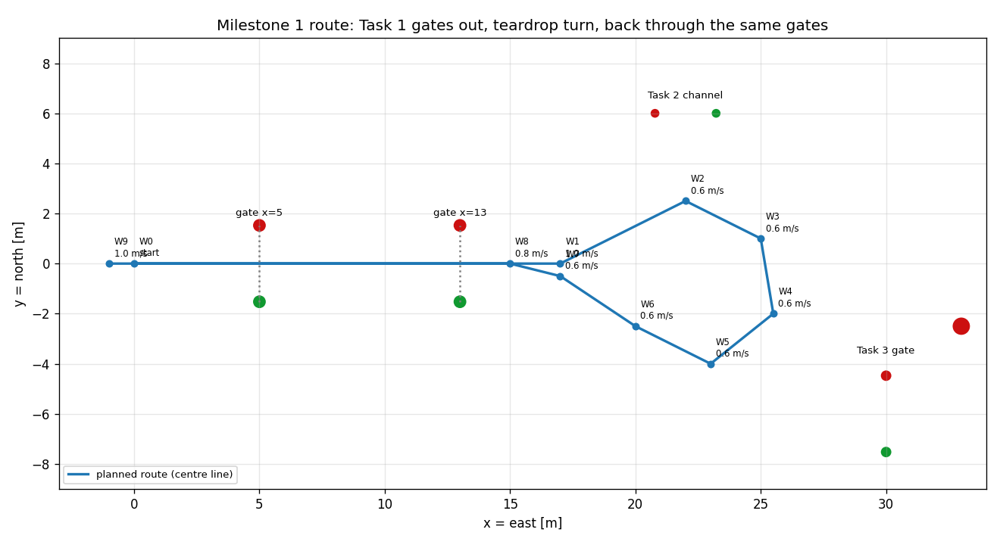

# Milestone 1 — Task 1 autonomously in simulation

**How this file is used (added 2026-10-10).** Step N here is step M1.N in
`docs/master_plan.md`, where its status mark lives. The step protocol in
`CLAUDE.md` applies (brief → Marcell's go → build → report → one commit
`M1.N: ...`); each step's brief and report are saved under the step below.
Steps 0 and 1 were done before the protocol existed (commits 9cc9fe7 and
f830b90). Section 10 lists open points in the Step 2 design that the M1.2 brief
must settle with Marcell. Symbols follow `docs/glossary.md` (the guidance
symbols there are "proposed" until Marcell accepts them).

**Goal:** the boat drives RoboBoat Task 1 (Evacuation Route & Return) by itself
in Gazebo: from the start, through both entry gates, a turn, and back out
through the same gates, using its real (simulated) thrusters. No keyboard, no
human input after launch.

**Why this first:** it closes the loop "the boat moves → the sensors produce
data → the data can be recorded". It is also the mandatory qualification task
of the competition. It uses Gazebo's ground-truth position; the filter output
can replace it in the optional step M7.3 (same message type, a different
topic).

**Scope note:** path planning and motor control are open taskforce subsystems.
The follower built here is a deliberately simple *test driver* with clean
interfaces (section 4), so that a colleague's planner or controller can
replace it later without touching anything else.

---

## 1. Success criteria (all must hold)

1. **One command** starts the simulation and the run: `ros2 launch asv_sim task1.launch.py`.
2. **Both gates, both directions:** the boat passes between both buoy pairs
   outbound and inbound, with at least 0.5 m clearance between its side and
   any buoy.
3. **No collision** with any buoy (minimum distance logged, measured against
   the nominal buoy positions; see section 8).
4. **It stops by itself** after the exit gates (thrust 0, status `FINISHED`).
5. **Repeatable:** 3 consecutive runs succeed.
6. **Observable:** the planned route, the current target point and the status
   are published as topics (visible in RViz, which Marcell chose for live data:
   decision D18 a in the master plan).
7. **Tested and documented:** unit tests pass; `ws/src/asv_sim/docs/AUTONOMY.md`
   explains the method with its equations and the tuned parameters.

## 2. The route

Course geometry (from `worlds/roboboat_course.sdf`): the boat spawns at (0, 0)
facing east; the entry gates are at x = 5 m and x = 13 m, each a red buoy at
y = +1.524 and a green buoy at y = −1.524 (Taylor Made Sur-Mark, radius
0.23 m). Task 2's channel starts at y = 6 (north), Task 3's gate is at x = 30
(south-east), so the turn goes clockwise through the space between them.



| Waypoint | x [m] | y [m] | Speed towards it [m/s] | Role |
|---|---|---|---|---|
| W0 | 0 | 0 | – | start (spawn position) |
| W1 | 17 | 0 | 1.0 | straight out through both gates |
| W2 | 22 | 2.5 | 0.6 | set up the turn (swing slightly north) |
| W3 | 25 | 1 | 0.6 | teardrop turn, clockwise |
| W4 | 25.5 | −2 | 0.6 | |
| W5 | 23 | −4 | 0.6 | |
| W6 | 20 | −2.5 | 0.6 | |
| W7 | 17 | −0.5 | 0.6 | rejoin the centre line |
| W8 | 15 | 0 | 0.8 | aligned 2 m before gate 2 |
| W9 | −1 | 0 | 1.0 | out through both gates, stop |

Route length 57 m. Checked clearance of the centre line to every buoy, minus
the buoy radius and the boat's half width (0.44 m): 0.86 m at the gate buoys
(passing through the centre), 3.2 m to the Task 2 channel buoys, more to all
others. The waypoints live in a parameter file, not in code (section 6).

## 3. Architecture

```
 /asv/ground_truth/odom ──► waypoint_follower (C++ node) ──► /asv/thrusters/{left,right}/{thrust,pos}
 (optional M7.3: /asv/slam/odom)  │                               (to Gazebo via the bridge)
                                 │ uses, pure C++ / no ROS:
                                 │   asv_sim::Route          route progression, cross-track error
                                 │   asv_sim::LosGuidance    desired heading (line of sight)
                                 │   asv_sim::HeadingControl steer + spin from heading error
                                 │   asv_sim::SpeedControl   throttle from speed error
                                 │   asv_sim::mix()          -> four thruster commands (new, Step 2)
                                 │   asv_sim::GateMonitor    detects gate passages
                                 ▼
          /asv/autonomy/path (nav_msgs/Path), /asv/autonomy/target (geometry_msgs/PointStamped),
          /asv/autonomy/status (std_msgs/String), /asv/autonomy/cross_track_error (std_msgs/Float64)
```

**All maths in plain C++ classes without ROS** (unit tested, reusable), and a
**thin node** for ROS I/O. The node runs a fixed 20 Hz control loop on a
ROS-clock timer (`rclcpp::create_timer(this, get_clock(), ...)`, so it runs in
simulation time; step M0.2 comes first) and always uses the latest odometry
message.

## 4. Interfaces (the contract other subsystems can rely on)

| Direction | Topic | Type | Meaning |
|---|---|---|---|
| in | `odom_topic` parameter, default `/asv/ground_truth/odom` | nav_msgs/Odometry | pose in world (ENU), twist in body frame |
| out | `/asv/thrusters/{left,right}/thrust` | std_msgs/Float64 | N |
| out | `/asv/thrusters/{left,right}/pos` | std_msgs/Float64 | pod angle, rad |
| out | `/asv/autonomy/path` | nav_msgs/Path | the planned route (latched: transient local) |
| out | `/asv/autonomy/target` | geometry_msgs/PointStamped | current line-of-sight target point |
| out | `/asv/autonomy/status` | std_msgs/String | `WAITING`, `RUNNING 1/9` … `RUNNING 9/9` (segment number / n_w), `FINISHED`, `STOPPED: <reason>`, gate events |
| out | `/asv/autonomy/cross_track_error` | std_msgs/Float64 | m, for plotting |

## 5. Algorithms

Notation: boat position $\mathbf p = (x, y)$ and heading $\psi$ in the world
frame; forward speed $u$ and yaw rate $\omega$ in the body frame (from the odometry
twist). The heading comes from the orientation quaternion:
$\psi = \operatorname{atan2}\big(2(q_w q_z + q_x q_y),\ 1 - 2(q_y^2 + q_z^2)\big)$.
Angle differences are always wrapped to $(-\pi, \pi]$.

### 5.1 Route progression (`Route`)
The route is a polyline $W_0 \dots W_{n_w}$ ($n_w = 9$); the boat follows segment
$i$ from $W_i$ to $W_{i+1}$, with direction
$\gamma_i = \operatorname{atan2}(W_{i+1,y} - W_{i,y},\ W_{i+1,x} - W_{i,x})$
and length $\ell_i$. Expressed in the segment's frame:

$$s = (\mathbf p - W_i)\cdot\hat t, \qquad e = (\mathbf p - W_i)\cdot\hat n,
\qquad \hat t = (\cos\gamma_i, \sin\gamma_i),\ \hat n = (-\sin\gamma_i, \cos\gamma_i)$$

$s$ is the along-track progress, $e$ the cross-track error ($e > 0$: boat is
left of the path). **Switching:** go to the next segment when
$s \ge \ell_i - R_\text{switch}$ (the boat has reached or passed the waypoint
*along the path*). This "passed" test, unlike a pure distance circle, can never
make the boat circle a waypoint it missed by a little.

### 5.2 Line-of-sight guidance (`LosGuidance`)
The standard path-following law for marine vehicles (Fossen, *Handbook of
Marine Craft Hydrodynamics and Motion Control*): aim at a point a lookahead
distance $\Delta$ ahead on the path:

$$\psi_d = \gamma_i + \operatorname{atan2}(-e, \Delta)$$

Far from the path the boat heads almost straight back to it; on the path it
heads along it. $\Delta$ is the main tuning knob: small → tight tracking but
oscillation; large → smooth but corners are cut. Start with $\Delta = 3$ m
(about two boat lengths). The target point $W_i + (s + \Delta)\hat t$ is
published for visualisation (but see section 10.6: in the loop it can leave
the route).

### 5.3 Heading control (`HeadingControl`)
Heading error $\tilde\psi = \operatorname{wrap}(\psi_d - \psi)$, positive =
the desired heading is to the left. A PD law with the derivative taken on the
measured yaw rate (no kick when the target jumps at a waypoint switch):

$$\text{steer} = \operatorname{clamp}\big(K_\psi\,\tilde\psi - K_\omega\,\omega,\ \pm\text{max\_steer}\big)$$

Steering the pods only turns the boat while there is thrust, so for large
errors (sharp turns, slow speed) **spin assist** adds differential thrust:

$$\text{spin} = \begin{cases}\operatorname{clamp}(K_\text{spin}\,\tilde\psi,\ \pm\text{spin\_max}) & |\tilde\psi| > \psi_\text{spin}\\ 0 & \text{otherwise}\end{cases}$$

(With the starting values this is an on/off switch; section 10.3.)

Signs follow `mix()`: steer > 0 and spin > 0 both turn the boat
counter-clockwise (left), **as long as the thrust is forward** (section 10.2).

### 5.4 Speed control (`SpeedControl`)
Commanded speed: the waypoint's speed, reduced when the boat points the wrong
way and when it approaches the final waypoint:

$$u_\text{cmd} = \min\big(u_i \cdot \max(0, \cos\tilde\psi),\ K_\text{stop}\, d_\text{end}\big)$$

($d_\text{end}$ is defined in the Step 2 brief; section 10.7.)

Throttle = **model-based feedforward + PI correction**. The simulated drag is
known exactly - it is the boat's own `hydrodynamics` in `config/asv.yaml`
(surge: $X = -(X_u + X_{uu}|u|)\,u$) - so the thrust needed to hold a speed is
known too, and the PI only corrects what the model gets wrong:

$$T_\text{ff}(u) = X_u u + X_{uu} u|u|, \qquad
\text{throttle} = \frac{T_\text{ff}(u_\text{cmd})}{2\,T_\text{max}} + K_P(u_\text{cmd}-u) + K_I\!\int(u_\text{cmd}-u)\,dt$$

clamped to $[-0.3, 1]$, with anti-windup (stop integrating while saturated).
Example: 1.0 m/s needs $4 + 6 = 10$ N in total, i.e. 5 N per thruster
(throttle 0.1 at 50 N max).

### 5.5 Allocation (`mix()`, new in Step 2)
`asv_sim::mix(throttle, steer, spin)` turns the three values into the four
thruster commands. It does not exist yet (no C++ code has been written so far).
Proposed specification, to be agreed in the Step 2 brief (section 10.1):

- left thrust $= \operatorname{clamp}\big(T_\text{max}(\text{throttle} - \text{spin}),\ T_\text{min},\ T_\text{max}\big)$
- right thrust $= \operatorname{clamp}\big(T_\text{max}(\text{throttle} + \text{spin}),\ T_\text{min},\ T_\text{max}\big)$
- both pod angles $= \operatorname{clamp}(-\text{steer},\ \pm\text{steer\_limit})$

with $T_\text{max} = 50$ N, $T_\text{min} = -40$ N and steer_limit = 1.5708 rad
from `config/asv.yaml`. Gazebo's thruster plugin also clamps to −40…50 N.

### 5.6 Gate monitor (`GateMonitor`)
Gates are given as buoy pairs (red, green). Each control step, the segment from
the previous to the current boat position is intersected with each gate
segment. On a crossing it reports: gate name, direction (outbound/inbound,
from the sign of the cross product), lateral offset from the gate centre, and
**pass/fail**: pass if the boat's side stays at least `gate_margin` (0.5 m)
from the surface of both buoys, i.e.

$$|\text{offset}| \le \tfrac{1}{2}\,\text{gate width} - r_b - \text{boat\_half\_width} - \text{gate\_margin}
= 1.524 - 0.2286 - 0.44 - 0.5 = 0.355\ \text{m}$$

with the buoy radius $r_b$ = 0.2286 m (`models/rb26_surmark_red/model.sdf`).
Also tracks the minimum distance from the boat's side to the surface of every
buoy (collision check, same radius). Results go to the status topic and the
log.

### 5.7 Safety and states
`WAITING` (no odometry yet, or the start delay - 3 s, lets the boat settle on
the water) → `RUNNING 1/9` … `RUNNING 9/9` → `FINISHED` (all thrust 0, pods
straight; when it fires on the last segment is set in the Step 2 brief,
section 10.7). `STOPPED: <reason>` from any state if the odometry is older
than 0.5 s or the run exceeds `max_run_time`: commands go to zero immediately.
All durations are in simulation time: the odometry age is
`now() − odom.header.stamp` with the node on `use_sim_time`. The node
publishes commands every cycle in every state, so "stopped" is actively
commanded, not just "no more messages".

## 6. Parameters (`config/task1_route.yaml`, ROS parameter file)

```yaml
waypoint_follower:
  ros__parameters:
    odom_topic: /asv/ground_truth/odom
    control_rate: 20.0          # Hz
    start_delay: 3.0            # s after the first odometry message
    max_run_time: 180.0         # s
    odom_timeout: 0.5           # s
    # route (W1..W9; W0 is wherever the boat starts)
    waypoints_x: [17.0, 22.0, 25.0, 25.5, 23.0, 20.0, 17.0, 15.0, -1.0]
    waypoints_y: [0.0, 2.5, 1.0, -2.0, -4.0, -2.5, -0.5, 0.0, 0.0]
    speeds:      [1.0, 0.6, 0.6, 0.6, 0.6, 0.6, 0.6, 0.8, 1.0]
    switch_distance: 1.5        # m, R_switch
    lookahead: 3.0              # m, Delta
    # heading control (starting values - tuned in step 5)
    heading_kp: 1.2             # rad steer per rad error (K_psi)
    heading_kd: 0.6             # rad steer per rad/s yaw rate (K_omega)
    max_steer: 0.8              # rad
    spin_threshold: 0.8         # rad (~45 deg)
    spin_kp: 0.5
    spin_max: 0.4
    # speed control
    speed_kp: 0.3               # throttle per m/s error
    speed_ki: 0.05
    stop_gain: 0.5              # 1/s, K_stop
    # gates: name + red buoy (x, y) + green buoy (x, y)
    gate_names: [gate1, gate2]
    gate_coords: [5.0, 1.524, 5.0, -1.524, 13.0, 1.524, 13.0, -1.524]
    gate_margin: 0.5            # m between the boat's side and a buoy's surface
    buoy_radius: 0.2286         # m, Sur-Mark (models/rb26_surmark_*/model.sdf)
    boat_half_width: 0.44       # m (= hull spacing/2 + hull radius; see 10.8)
```

The boat's own values - drag coefficients ($X_u$, $X_{uu}$), `max_thrust`,
`min_thrust` and `steer_limit` - are **not** repeated here: the launch file
reads them from `config/asv.yaml` (single source of truth, as for everything
else) and passes them as parameters.

## 7. Implementation steps (for Claude Code - one at a time)

Each step follows the step protocol in `CLAUDE.md`: brief, Marcell's go,
build, report, one commit `M1.N: ...`. The brief and the report are saved
under the step here.

### Step 0 — Set up and verify the current state  (M1.0, done)
Original plan: `git init` with a `.gitignore`, first build of `asv_sim`, check
build, tests and the headless sim.

**Report (from commit 9cc9fe7, 2026-10-05):** package skeleton
(`package.xml`, `CMakeLists.txt` with no C++ targets) and `launch/sim.launch.py`
(Gazebo with `gui:=false`, the bridge, 9 static TF publishers). `colcon build`
clean; 28 Python tests pass; there was no C++ code, so there were no C++ tests;
the headless sim publishes `/asv/ground_truth/odom` at about 46 Hz (Gazebo is
set to 50 Hz) and all 9 static TF frames.

### Step 1 — Actuator check (measure before controlling)  (M1.1, done)
A small tool (`tools/actuator_check.py`) that commands fixed values with
the boat on the water and records the response from the odometry:
1. total thrust 10, 20, 40 N (half per thruster), pods straight → steady
   forward speed; compare with the drag model's prediction
   ($X_u u + X_{uu}u^2 = T$);
2. 20 N total with pods at −0.4 rad → yaw rate must be **positive** (turns
   left): **confirms the steering sign** (see CLAUDE.md);
3. spin: left −10 N, right +10 N → yaw rate positive.

**Report (from commit f830b90 and CLAUDE.md):** 10 N → 1.00 m/s, 20 N →
1.52 m/s, 40 N → 2.27 m/s, all within 0.1 % of the drag model; pods at
−0.4 rad → +0.15 rad/s (left turn); left −10 N / right +10 N → +0.18 rad/s
(left turn). The tool times its phases with the wall clock; step M0.2 decides
whether it is switched to simulation time.

### Step 2 — Guidance and control logic (pure C++, no ROS)  (M1.2)
First C++ code in `asv_sim`: a library target and gtest in `CMakeLists.txt`,
⚠ new `<test_depend>ament_cmake_gtest</test_depend>` in `package.xml` (ask
first). `include/asv_sim/mix.hpp`: `mix()` (section 5.5).
`include/asv_sim/guidance.hpp` (+ `.cpp` if it gets long): `Route`,
`LosGuidance`, `HeadingControl`, `SpeedControl`, `GateMonitor`, angle
wrapping, yaw from quaternion. The brief settles the open points of section 10.
Unit tests in `test/test_mix.cpp` and `test/test_guidance.cpp`:
- `mix()`: steer > 0 gives pod angles < 0; spin > 0 gives left < right
  thrust; clamping to −40…50 N and ±1.5708 rad;
- cross-track error sign and segment switching (incl. a missed waypoint);
- LOS heading on, left of and right of the path;
- angle wrapping across ±π (the turn passes through west = ±180°!);
- gate crossing: pass, fail (too close to a buoy: the 0.355 m band of 5.6),
  direction;
- the rules the M1.2 brief chooses for section 10 (steering with reverse
  thrust, spin assist);
- **closed-loop logic test without Gazebo:** a simple kinematic boat model
  (speed with a first-order lag; turning either "yaw rate ∝ steer·u + spin" as
  first planned, or calibrated from Step 1 as proposed in 10.5, as the brief
  decides) follows the Task 1 route and passes both gates both ways. This
  catches logic errors in seconds; real dynamics are tuned in Gazebo (step 5).
- **Check:** all tests pass (`colcon test` now runs the gtests; the 28 Python
  tests still pass).

### Step 3 — The node (`src/waypoint_follower.cpp`)  (M1.3)
Parameters (section 6), odometry subscription, 20 Hz ROS-clock timer, the
state machine (5.7), publishing commands + the four autonomy topics (`path`
with transient-local QoS so late viewers still get it). ⚠ New `<depend>`
entries `rclcpp`, `std_msgs`, `nav_msgs`, `geometry_msgs` (ask first). Needs
M0.2 (simulation time) done first.
- **Check:** builds without warnings; with the sim running headless and the
  node started by hand (`ros2 run asv_sim waypoint_follower --ros-args -p
  use_sim_time:=true --params-file <path>/task1_route.yaml`, plus the boat
  values that the launch file normally passes, section 6; the brief says how),
  the status goes
  `WAITING` → `RUNNING 1/9` and the boat's x position increases.

### Step 4 — One-command launch (`launch/task1.launch.py`)  (M1.4)
Includes `sim.launch.py` (arguments passed through, e.g. `gui:=false`), starts
`waypoint_follower` with `config/task1_route.yaml` plus the drag, thrust and
steering values read from `config/asv.yaml`; sets `use_sim_time` for all nodes
(`SetParameter(name='use_sim_time', value=True)`).
- **Check:** `ros2 launch asv_sim task1.launch.py gui:=false` runs the
  whole task; the log shows the gate events and `FINISHED`.

### Step 5 — Tuning and evaluation  (M1.5)
Run, read the log (gate offsets, minimum buoy distance, cross-track error,
time), adjust gains in the YAML, repeat. A small analysis tool
(`tools/analyze_run.py`) that reads a recorded run and prints the metrics, so
runs can be compared objectively. Recording:
`timeout -s INT <s> ros2 bag record --use-sim-time -o /ws/data/bags/task1_<n>
--topics /clock /asv/ground_truth/odom /asv/autonomy/status
/asv/autonomy/cross_track_error /asv/autonomy/target`.
- **Check:** criteria 2–5 of section 1 met in 3 consecutive runs; final gains
  and results recorded.

### Step 6 — Documentation  (M1.6)
`ws/src/asv_sim/docs/AUTONOMY.md`: route, architecture, the equations of
section 5, chosen parameters and why, measured results (table from step 5),
known limitations. Create or update `README.md` (repo root) with the run
command.
- **Check:** Marcell has read it and can explain every part.

### Step 7 — Maneuver player  (M1.7)
Plays a timed list of (t, throttle, steer, spin) from YAML through `mix()`,
open loop, timed in simulation time; waits for the first `/clock` message
before starting. For simple, repeatable test runs (straight line, circle,
zig-zag).
- **Check:** the same maneuver run twice; the largest difference between the
  two true trajectories is measured and reported.

### Step 8 — Keyboard teleop (WASD)  (M1.8)
C++, calls `mix()`. W/S change the throttle level, A/D the steer level and Q/E
the spin level, in steps; Space sets everything to zero. Levels stay set after
the key is released (a terminal sends no key-release events). Publishes zero
on exit. The key-to-command logic is a ROS-free function with unit tests; the
node only reads keys and publishes. Started only by Marcell in his own
terminal (`ros2 run asv_sim teleop --ros-args -p use_sim_time:=true`), never
from a launch file. Never runs together with the follower or player.
- **Check:** unit tests pass; Marcell drives the boat with it (Claude Code
  can't press keys).

## 8. Known risks and open points

| Risk | Mitigation |
|---|---|
| No C++ code existed before Step 2 (found 2026-10-10; older notes said `mix()` existed) | Step 2 writes `mix()` and sets up gtest before anything builds on it |
| Steering sign wrong | Step 1 measured it (confirmed); the reverse-thrust case is open (10.2) |
| Turn too tight for the boat at 0.6 m/s | pods alone turn with a radius of about 6.4–7 m, the teardrop needs about 2.4–3.2 m (10.4), so spin assist is the main way to turn, not a fallback. Widening the teardrop (move W3–W5 east, max x ≈ 27 to keep 3 m from Task 3) adds roughly 1 m of radius [EST], so spin assist stays needed |
| Waves disturb tracking | start with the world's small default waves; increase `gain` later as a robustness test |
| Uncalibrated drag → feedforward off | Step 1 showed the drag model matches Gazebo within 0.1 %; the PI term corrects the rest |
| Ground truth is "too perfect" | intended (master plan idea 3); the optional M7.3 swaps in `/asv/slam/odom` via `odom_topic` |
| Buoys float freely (no mooring), gate checks use nominal positions | distances are logged against nominal positions; the true buoy drift is measured in M2.7 |

## 9. Out of scope (later milestones)
Recording datasets (master plan M2.9), the filter (M3–M4), detecting the gates
with the sensors instead of using known positions (M5, only if time), obstacle avoidance,
other tasks. A Foxglove dashboard and shore-link topics were planned here for
Milestones 2–3; Marcell decided on 2026-10-11 to use RViz for live data (D18 a),
so they are only the optional, unplanned step M7.6.

## 10. Open points for the Step 2 brief (found 2026-10-10)

Found while checking this plan against the master plan and the repository
(commit 6b8be2b). Numbers are [EST] from the drag model unless marked. The
M1.2 brief lists each point with options and a recommendation; Marcell
decides.

1. **`mix()` specification.** Section 5.5 is a proposal. Still open: what
   happens when throttle ± spin saturates (keep the spin difference and lower
   both, or clip each side), and whether throttle and spin are fractions of
   `max_thrust` (as proposed) or newtons.
2. **Steering with reverse thrust.** The yaw moment of the pods is
   $-0.70\,(T_L + T_R)\sin\delta + 0.33\,(T_R - T_L)\cos\delta$
   ($\delta$ = pod angle; pods 0.70 m behind base_link, which is close to
   the centre of gravity, and 0.33 m to each side [REPO `asv.yaml`]). With
   negative mean thrust the pods turn the boat the wrong way. This happens in normal operation: with $u_\text{cmd} = u_i
   \cos\tilde\psi$ and $K_P = 0.3$, at 0.6 m/s the throttle is negative for
   $|\tilde\psi| \gtrsim 0.62$ rad (36°), before the integral term (−0.011 at
   0.7 rad, −0.063 at 1.0 rad), and every teardrop corner turns by 53–65°.
   Below the spin threshold (0.8 rad) nothing else turns the boat. Options:
   a) steer = 0 when throttle ≤ 0; b) pod angle = −steer·sign(throttle) in
   `mix()`; c) throttle ≥ 0 while turning (|ψ̃| above a threshold).
   Recommended: c (the pods always push forward, so the sign rule always holds;
   a and b switch at throttle ≈ 0 and can chatter). Needs a unit test.
3. **Spin assist is on/off.** At the threshold, $K_\text{spin}\psi_\text{spin}
   = 0.5 \cdot 0.8 = 0.4$ = spin_max, so spin jumps from 0 to ±0.4 (±20 N per
   side) and can chatter around |ψ̃| = 0.8 rad. Proposed: spin =
   sign(ψ̃)·clamp(K_spin(|ψ̃| − ψ_spin), 0, spin_max), with a new starting
   value for K_spin, and a unit test that spin is continuous at the threshold.
4. **The teardrop needs spin.** The four loop corners (W2–W5) turn the heading
   by 233°. Spread over the path from W2 to W6 (12.95 m) that is a mean turning
   radius of about 3.2 m; over W2 to W5 (9.6 m) about 2.4 m. So the boat needs
   about 0.19–0.25 rad/s at 0.6 m/s. With the pods alone at max_steer 0.8 rad
   the steady turning radius is about 6.4 m if the speed PI holds 0.6 m/s, or
   about 7 m if the thrust stays at the feedforward value (the boat then slows
   to about 0.47 m/s). So spin assist is part of every loop corner (risk
   table).
5. **Calibrated test model for Step 2.** Instead of "yaw rate ∝ steer·u +
   spin" (an arbitrary gain that can pass with any controller), use the
   steady-state yaw balance $n_R\,\omega + n_{RR}\,\omega|\omega|$ = yaw
   moment of point 2, with $n_R = n_{RR} = 32$ [REPO `asv.yaml`]. It reproduces
   Step 1: 0.148 rad/s for the pod test (measured 0.15) and 0.175 rad/s for
   the differential test (measured 0.18). Optionally a first-order lag on ω.
6. **Lookahead vs. short segments.** Δ = 3 m is about as long as the loop
   segments (2.06–3.61 m; only W7–W8 is shorter than 3 m), and with R_switch = 1.5 m each loop
   segment is followed for only about 0.6–2 m. At a switch the target point
   $W_i + (s + \Delta)\hat t$ lies on the segment's extension, up to about
   1.4 m off the route. Options: carry the leftover lookahead onto the next
   segment (target stays on the route; recommended), or a smaller Δ in the
   loop.
7. **d_end and FINISHED.** $d_\text{end}$ is not defined. As a straight line
   to W9 it would slow the start, because the boat spawns 1 m from W9 =
   (−1, 0). Proposed: $d_\text{end}$ = remaining distance along the route
   ($\ell_i - s$ plus the later segments). Also say when FINISHED fires: on
   the last segment when $s \ge \ell_8 - R_\text{switch}$ (x ≤ 0.5 m), or at
   W9.
8. **Parameter sources.** `boat_half_width` (0.44 m = 0.66/2 + 0.11 from
   `asv.yaml`) should be computed by the launch file like the drag values;
   `gate_coords` and `buoy_radius` repeat the world and model files and can
   come from the ground-truth buoy file once M2.7 exists. Every parameter gets
   a source tag (CLAUDE.md): [EST] for the starting gains, [REPO] for the
   geometry.
