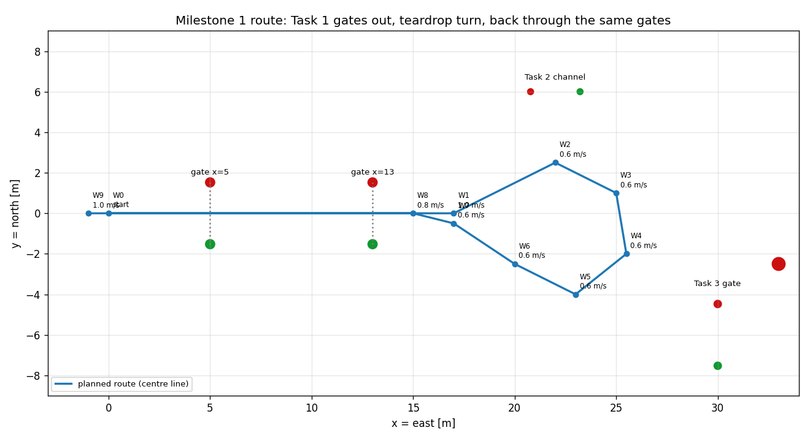

# Milestone 1 — Task 1 autonomously in simulation

**How this file is used (added 2026-10-10).** Step N here is step M1.N in
`docs/master_plan.md`, where its status mark lives. The step protocol in
`CLAUDE.md` applies (brief → Marcell's go → build → report → one commit
`M1.N: ...`); each step's brief and report are saved under the step below.
Steps 0 and 1 were done before the protocol existed (commits 9cc9fe7 and
f830b90). Section 10 lists open points in the Step 2 design that the M1.2 brief
must settle with Marcell. Symbols follow `docs/glossary.md` (the guidance
symbols there are "proposed" until Marcell accepts them).

**Goal:** the boat drives RoboBoat Task 1 (Evacuation Route & Return) by itself
in Gazebo: from the start, through both entry gates, a turn, and back out
through the same gates, using its real (simulated) thrusters. No keyboard, no
human input after launch.

**Why this first:** it closes the loop "the boat moves → the sensors produce
data → the data can be recorded". It is also the mandatory qualification task
of the competition. It uses Gazebo's ground-truth position; the filter output
can replace it in the optional step M7.3 (same message type, a different
topic).

**Scope note:** path planning and motor control are open taskforce subsystems.
The follower built here is a deliberately simple *test driver* with clean
interfaces (section 4), so that a colleague's planner or controller can
replace it later without touching anything else.

---

## 1. Success criteria (all must hold)

1. **One command** starts the simulation and the run: `ros2 launch asv_sim task1.launch.py`.
2. **Both gates, both directions:** the boat passes between both buoy pairs
   outbound and inbound, with at least 0.5 m clearance between its side and
   any buoy.
3. **No collision** with any buoy (minimum distance logged, measured against
   the nominal buoy positions; see section 8).
4. **It stops by itself** after the exit gates (thrust 0, status `FINISHED`).
5. **Repeatable:** 3 consecutive runs succeed.
6. **Observable:** the planned route, the current target point and the status
   are published as topics (visible in RViz, which Marcell chose for live data:
   decision D18 a in the master plan).
7. **Tested and documented:** unit tests pass; `ws/src/asv_sim/docs/AUTONOMY.md`
   explains the method with its equations and the tuned parameters.

## 2. The route

Course geometry (from `worlds/roboboat_course.sdf`): the boat spawns at (0, 0)
facing east; the entry gates are at x = 5 m and x = 13 m, each a red buoy at
y = +1.524 and a green buoy at y = −1.524 (Taylor Made Sur-Mark, radius
0.23 m). Task 2's channel starts at y = 6 (north), Task 3's gate is at x = 30
(south-east), so the turn goes clockwise through the space between them.



| Waypoint | x [m] | y [m] | Speed towards it [m/s] | Role |
|---|---|---|---|---|
| W0 | 0 | 0 | – | start (spawn position) |
| W1 | 17 | 0 | 1.0 | straight out through both gates |
| W2 | 22 | 2.5 | 0.6 | set up the turn (swing slightly north) |
| W3 | 25 | 1 | 0.6 | teardrop turn, clockwise |
| W4 | 25.5 | −2 | 0.6 | |
| W5 | 23 | −4 | 0.6 | |
| W6 | 20 | −2.5 | 0.6 | |
| W7 | 17 | −0.5 | 0.6 | rejoin the centre line |
| W8 | 15 | 0 | 0.8 | aligned 2 m before gate 2 |
| W9 | −1 | 0 | 1.0 | out through both gates, stop |

Route length 57 m. Checked clearance of the centre line to every buoy, minus
the buoy radius and the boat's half width (0.44 m): 0.86 m at the gate buoys
(passing through the centre), 3.2 m to the Task 2 channel buoys, more to all
others. The waypoints live in a parameter file, not in code (section 6).

## 3. Architecture

```
 /asv/ground_truth/odom ──► waypoint_follower (C++ node) ──► /asv/thrusters/{left,right}/{thrust,pos}
 (optional M7.3: /asv/slam/odom)  │                               (to Gazebo via the bridge)
                                 │ uses, pure C++ / no ROS:
                                 │   asv_sim::Route          route progression, cross-track error
                                 │   asv_sim::LosGuidance    desired heading (line of sight)
                                 │   asv_sim::HeadingControl steer + spin from heading error
                                 │   asv_sim::SpeedControl   throttle from speed error
                                 │   asv_sim::mix()          -> four thruster commands (new, Step 2)
                                 │   asv_sim::GateMonitor    detects gate passages
                                 ▼
          /asv/autonomy/path (nav_msgs/Path), /asv/autonomy/target (geometry_msgs/PointStamped),
          /asv/autonomy/status (std_msgs/String), /asv/autonomy/cross_track_error (std_msgs/Float64)
```

**All maths in plain C++ classes without ROS** (unit tested, reusable), and a
**thin node** for ROS I/O. The node runs a fixed 20 Hz control loop on a
ROS-clock timer (`rclcpp::create_timer(this, get_clock(), ...)`, so it runs in
simulation time; step M0.2 comes first) and always uses the latest odometry
message.

## 4. Interfaces (the contract other subsystems can rely on)

| Direction | Topic | Type | Meaning |
|---|---|---|---|
| in | `odom_topic` parameter, default `/asv/ground_truth/odom` | nav_msgs/Odometry | pose in world (ENU), twist in body frame |
| out | `/asv/thrusters/{left,right}/thrust` | std_msgs/Float64 | N |
| out | `/asv/thrusters/{left,right}/pos` | std_msgs/Float64 | pod angle, rad |
| out | `/asv/autonomy/path` | nav_msgs/Path | the planned route (latched: transient local) |
| out | `/asv/autonomy/target` | geometry_msgs/PointStamped | current line-of-sight target point |
| out | `/asv/autonomy/status` | std_msgs/String | `WAITING`, `RUNNING 1/9` … `RUNNING 9/9` (segment number / n_w), `FINISHED`, `STOPPED: <reason>`, gate events |
| out | `/asv/autonomy/cross_track_error` | std_msgs/Float64 | m, for plotting |

## 5. Algorithms

Notation: boat position $\mathbf p = (x, y)$ and heading $\psi$ in the world
frame; forward speed $u$ and yaw rate $\omega$ in the body frame (from the odometry
twist). The heading comes from the orientation quaternion:
$\psi = \operatorname{atan2}\big(2(q_w q_z + q_x q_y),\ 1 - 2(q_y^2 + q_z^2)\big)$.
Angle differences are always wrapped to $(-\pi, \pi]$.

### 5.1 Route progression (`Route`)
The route is a polyline $W_0 \dots W_{n_w}$ ($n_w = 9$); the boat follows segment
$i$ from $W_i$ to $W_{i+1}$, with direction
$\gamma_i = \operatorname{atan2}(W_{i+1,y} - W_{i,y},\ W_{i+1,x} - W_{i,x})$
and length $\ell_i$. Expressed in the segment's frame:

$$s = (\mathbf p - W_i)\cdot\hat t, \qquad e = (\mathbf p - W_i)\cdot\hat n,
\qquad \hat t = (\cos\gamma_i, \sin\gamma_i),\ \hat n = (-\sin\gamma_i, \cos\gamma_i)$$

$s$ is the along-track progress, $e$ the cross-track error ($e > 0$: boat is
left of the path). **Switching:** go to the next segment when
$s \ge \ell_i - R_\text{switch}$ (the boat has reached or passed the waypoint
*along the path*). This "passed" test, unlike a pure distance circle, can never
make the boat circle a waypoint it missed by a little.
At most one switch per control step. On the last segment the same test ends
the route (FINISHED, decision 10.7 a). The distance left to W_{n_w} is measured
along the route: $d_\text{end} = (\ell_i - s) + \sum_{j>i} \ell_j$.

### 5.2 Line-of-sight guidance (`LosGuidance`)
The standard path-following law for marine vehicles (Fossen, *Handbook of
Marine Craft Hydrodynamics and Motion Control*): aim at a point a lookahead
distance $\Delta$ ahead on the path:

$$\psi_d = \gamma_i + \operatorname{atan2}(-e, \Delta)$$

Far from the path the boat heads almost straight back to it; on the path it
heads along it. $\Delta$ is the main tuning knob: small → tight tracking but
oscillation; large → smooth but corners are cut. Start with $\Delta = 3$ m
(about two boat lengths).

**Implemented form (decision 10.6 a):** the target point $\mathbf p_\text{LOS}$
is found by walking $\Delta$ along the route from the boat's projection
$W_i + s\,\hat t$, carrying what is left past $W_{i+1}$ onto the next
segments (never past $W_{n_w}$), and

$$\psi_d = \operatorname{atan2}\big(\mathbf p_{\text{LOS},y} - y,\ \mathbf p_{\text{LOS},x} - x\big).$$

While $\mathbf p_\text{LOS}$ is on segment $i$ this is exactly the formula
above; near a corner the target stays on the route. $\mathbf p_\text{LOS}$ is
published as `/asv/autonomy/target`.

### 5.3 Heading control (`HeadingControl`)
Heading error $\tilde\psi = \operatorname{wrap}(\psi_d - \psi)$, positive =
the desired heading is to the left. A PD law with the derivative taken on the
measured yaw rate (no kick when the target jumps at a waypoint switch):

$$\text{steer} = \operatorname{clamp}\big(K_\psi\,\tilde\psi - K_\omega\,\omega,\ \pm\text{max\_steer}\big)$$

Steering the pods only turns the boat while there is thrust, so for large
errors (sharp turns, slow speed) **spin assist** adds differential thrust:

$$\text{spin} = \begin{cases}\operatorname{clamp}(K_\text{spin}\,\tilde\psi,\ \pm\text{spin\_max}) & |\tilde\psi| > \psi_\text{spin}\\ 0 & \text{otherwise}\end{cases}$$

**Implemented form (decision 10.3 b):** a ramp that starts at zero at the
threshold, so spin has no jump:

$$\text{spin} = \operatorname{sign}(\tilde\psi)\,\operatorname{clamp}\big(K_\text{spin}(|\tilde\psi| - \psi_\text{spin}),\ 0,\ \text{spin\_max}\big)$$

With K_spin = 1.0 it reaches spin_max = 0.4 at |ψ̃| = 1.2 rad.

Signs follow `mix()`: steer > 0 and spin > 0 both turn the boat
counter-clockwise (left), **as long as the thrust is forward** (section 10.2).

### 5.4 Speed control (`SpeedControl`)
Commanded speed: the waypoint's speed, reduced when the boat points the wrong
way and when it approaches the final waypoint:

$$u_\text{cmd} = \min\big(u_i \cdot \max(0, \cos\tilde\psi),\ K_\text{stop}\, d_\text{end}\big)$$

($d_\text{end}$ is defined in the Step 2 brief; section 10.7.)

Throttle = **model-based feedforward + PI correction**. The simulated drag is
known exactly - it is the boat's own `hydrodynamics` in `config/asv.yaml`
(surge: $X = -(X_u + X_{uu}|u|)\,u$) - so the thrust needed to hold a speed is
known too, and the PI only corrects what the model gets wrong:

$$T_\text{ff}(u) = X_u u + X_{uu} u|u|, \qquad
\text{throttle} = \frac{T_\text{ff}(u_\text{cmd})}{2\,T_\text{max}} + K_P(u_\text{cmd}-u) + K_I\!\int(u_\text{cmd}-u)\,dt$$

clamped to $[-0.3, 1]$, with anti-windup (stop integrating while saturated).

**Implemented form (decision 10.2 c):** while $|\tilde\psi| > \psi_\text{turn}$
(0.3 rad) the lower limit is 0 instead of −0.3, so the pods always push forward
in a turn and the steering sign holds. $u_\text{cmd}$ is also kept ≥ 0 (just
past the end $d_\text{end} < 0$). Anti-windup by conditional integration: the
error is integrated unless the output is beyond a limit and the error pushes
further that way. The time step comes from the odometry stamps.
Example: 1.0 m/s needs $4 + 6 = 10$ N in total, i.e. 5 N per thruster
(throttle 0.1 at 50 N max).

### 5.5 Allocation (`mix()`, new in Step 2)
`asv_sim::mix(throttle, steer, spin)` turns the three values into the four
thruster commands. It does not exist yet (no C++ code has been written so far).
Proposed specification, to be agreed in the Step 2 brief (section 10.1):

- left thrust $= \operatorname{clamp}\big(T_\text{max}(\text{throttle} - \text{spin}),\ T_\text{min},\ T_\text{max}\big)$
- right thrust $= \operatorname{clamp}\big(T_\text{max}(\text{throttle} + \text{spin}),\ T_\text{min},\ T_\text{max}\big)$
- both pod angles $= \operatorname{clamp}(-\text{steer},\ \pm\text{steer\_limit})$

with $T_\text{max} = 50$ N, $T_\text{min} = -40$ N and steer_limit = 1.5708 rad
from `config/asv.yaml`. Gazebo's thruster plugin also clamps to −40…50 N.

### 5.6 Gate monitor (`GateMonitor`)
Gates are given as buoy pairs (red, green). Each control step, the segment from
the previous to the current boat position is intersected with each gate
segment. On a crossing it reports: gate name, direction (outbound/inbound,
from the sign of the cross product), lateral offset from the gate centre, and
**pass/fail**: pass if the boat's side stays at least `gate_margin` (0.5 m)
from the surface of both buoys, i.e.

$$|\text{offset}| \le \tfrac{1}{2}\,\text{gate width} - r_b - \text{boat\_half\_width} - \text{gate\_margin}
= 1.524 - 0.2286 - 0.44 - 0.5 = 0.355\ \text{m}$$

with the buoy radius $r_b$ = 0.2286 m (`models/rb26_surmark_red/model.sdf`).
Also tracks the minimum distance from the boat's side to the surface of every
buoy (collision check, same radius). Results go to the status topic and the
log.

**Implemented form (M1.2d, decisions 10.9 a, 10.10 a, 10.11 b;
`gate_monitor.hpp`).** Gate g has red buoy a and green buoy b, width
$w_g = |b - a|$, unit vector $\hat u = (b - a)/w_g$. Side value
$f(q) = (b - a) \times (q - a)$; a crossing happens when $f \ge 0$ changes
between the previous position $p^-$ and $p$ (half-open, so landing exactly on
the line counts once). Crossing point $q = p^- + t(p - p^-)$,
$t = f(p^-)/(f(p^-) - f(p))$; offset $o = w_g/2 - (q - a)\cdot\hat u$ (> 0
towards red). Crossings with $|o| > w_g/2 + $ `gate_capture` are ignored.
Direction OUTBOUND if $(b - a) \times (p - p^-) > 0$ (Task 1: eastward).
Result: FAIL_OUTSIDE if $|o| > w_g/2$; PASS if
$-(w_g/2 - r_\text{green} - b_w - d_m) \le o \le w_g/2 - r_\text{red} - b_w - d_m$
(each buoy its own radius); FAIL_CLOSE otherwise. Clearance to buoy j with
the boat as a rectangle $L \times 2b_w$ centred on base_link:
$d = R(-\psi)(c_j - p)$, $k$ = $d$ clamped to $[-L/2, L/2] \times [-b_w, b_w]$,
$c_j = |d - k| - r_j$; the smallest per buoy and overall are kept, and a
collision is flagged once $c_j \le 0$. Sampled once per control step.

### 5.7 Safety and states
`WAITING` (no odometry yet, or the start delay - 3 s, lets the boat settle on
the water) → `RUNNING 1/9` … `RUNNING 9/9` → `FINISHED` (all thrust 0, pods
straight; when it fires on the last segment is set in the Step 2 brief,
section 10.7). `STOPPED: <reason>` from any state if the odometry is older
than 0.5 s or the run exceeds `max_run_time`: commands go to zero immediately.
All durations are in simulation time: the odometry age is
`now() − odom.header.stamp` with the node on `use_sim_time`. The node
publishes commands every cycle in every state, so "stopped" is actively
commanded, not just "no more messages".

## 6. Parameters (`config/task1_route.yaml`, ROS parameter file)

```yaml
waypoint_follower:
  ros__parameters:
    odom_topic: /asv/ground_truth/odom
    control_rate: 20.0          # Hz
    start_delay: 3.0            # s after the first odometry message
    max_run_time: 180.0         # s
    odom_timeout: 0.5           # s
    # route (W1..W9; W0 is wherever the boat starts)
    waypoints_x: [17.0, 22.0, 25.0, 25.5, 23.0, 20.0, 17.0, 15.0, -1.0]
    waypoints_y: [0.0, 2.5, 1.0, -2.0, -4.0, -2.5, -0.5, 0.0, 0.0]
    speeds:      [1.0, 0.6, 0.6, 0.6, 0.6, 0.6, 0.6, 0.8, 1.0]
    switch_distance: 1.5        # m, R_switch
    lookahead: 3.0              # m, Delta
    # heading control (starting values - tuned in step 5)
    heading_kp: 1.2             # rad steer per rad error (K_psi)
    heading_kd: 0.6             # rad steer per rad/s yaw rate (K_omega)
    max_steer: 0.8              # rad
    spin_threshold: 0.8         # rad (~45 deg), psi_spin
    spin_kp: 1.0                # 1/rad, K_spin (ramp, 10.3 b): spin_max at 1.2 rad
    spin_max: 0.4
    # speed control
    speed_kp: 0.3               # throttle per m/s error
    speed_ki: 0.05
    stop_gain: 0.5              # 1/s, K_stop
    turn_threshold: 0.3         # rad, psi_turn: throttle >= 0 above it (10.2 c)
    min_throttle: -0.3          # lower throttle limit when not turning
    max_throttle: 1.0
    # buoys (world frame, nominal) [REPO task pose x model pose]; radius per
    # model: Sur-Mark 0.2286, A0 0.1015, A2 0.184 m (models/rb26_*/model.sdf).
    # Gate buoys + nearby buoys (10.11 b); from buoys_gt.yaml after M2.7.
    buoy_names: [gate1_red, gate1_green, gate2_red, gate2_green,
                 t2_ch1_red, t2_ch1_green, t3_red, t3_green]
    buoy_coords: [5.0, 1.524, 5.0, -1.524, 13.0, 1.524, 13.0, -1.524,
                  20.781, 6.0, 23.219, 6.0, 30.0, -4.476, 30.0, -7.524]
    buoy_radii: [0.2286, 0.2286, 0.2286, 0.2286, 0.1015, 0.1015, 0.184, 0.184]
    # gates: name + red and green buoy by name (only the Task 1 gates are checked)
    gate_names: [gate1, gate2]
    gate_red: [gate1_red, gate2_red]
    gate_green: [gate1_green, gate2_green]
    gate_margin: 0.5            # m between the boat's side and a buoy's surface (d_m)
    gate_capture: 2.0           # m beyond a buoy centre still reported, FAIL_OUTSIDE [EST] (10.10)
    # boat_half_width (0.44 m) and boat_length (1.60 m) are computed by the
    # launch file from asv.yaml (10.8 a), not set here.
```

The boat's own values - drag coefficients ($X_u$, $X_{uu}$), `max_thrust`,
`min_thrust` and `steer_limit` - are **not** repeated here: the launch file
reads them from `config/asv.yaml` (single source of truth, as for everything
else) and passes them as parameters.

## 7. Implementation steps (for Claude Code - one at a time)

Each step follows the step protocol in `CLAUDE.md`: brief, Marcell's go,
build, report, one commit `M1.N: ...`. The brief and the report are saved
under the step here.

### Step 0 — Set up and verify the current state  (M1.0, done)
Original plan: `git init` with a `.gitignore`, first build of `asv_sim`, check
build, tests and the headless sim.

**Report (from commit 9cc9fe7, 2026-10-05):** package skeleton
(`package.xml`, `CMakeLists.txt` with no C++ targets) and `launch/sim.launch.py`
(Gazebo with `gui:=false`, the bridge, 9 static TF publishers). `colcon build`
clean; 28 Python tests pass; there was no C++ code, so there were no C++ tests;
the headless sim publishes `/asv/ground_truth/odom` at about 46 Hz (Gazebo is
set to 50 Hz) and all 9 static TF frames.

### Step 1 — Actuator check (measure before controlling)  (M1.1, done)
A small tool (`tools/actuator_check.py`) that commands fixed values with
the boat on the water and records the response from the odometry:
1. total thrust 10, 20, 40 N (half per thruster), pods straight → steady
   forward speed; compare with the drag model's prediction
   ($X_u u + X_{uu}u^2 = T$);
2. 20 N total with pods at −0.4 rad → yaw rate must be **positive** (turns
   left): **confirms the steering sign** (see CLAUDE.md);
3. spin: left −10 N, right +10 N → yaw rate positive.

**Report (from commit f830b90 and CLAUDE.md):** 10 N → 1.00 m/s, 20 N →
1.52 m/s, 40 N → 2.27 m/s, all within 0.1 % of the drag model; pods at
−0.4 rad → +0.15 rad/s (left turn); left −10 N / right +10 N → +0.18 rad/s
(left turn). The tool times its phases with the wall clock; step M0.2 decides
whether it is switched to simulation time.

### Step 2 — Guidance and control logic (pure C++, no ROS)  (M1.2)
First C++ code in `asv_sim`: a library target and gtest in `CMakeLists.txt`,
⚠ new `<test_depend>ament_cmake_gtest</test_depend>` in `package.xml` (ask
first). `include/asv_sim/mix.hpp`: `mix()` (section 5.5).
`include/asv_sim/guidance.hpp` (+ `.cpp` if it gets long): `Route`,
`LosGuidance`, `HeadingControl`, `SpeedControl`, `GateMonitor`, angle
wrapping, yaw from quaternion. The brief settles the open points of section 10.
Unit tests in `test/test_mix.cpp` and `test/test_guidance.cpp`:
- `mix()`: steer > 0 gives pod angles < 0; spin > 0 gives left < right
  thrust; clamping to −40…50 N and ±1.5708 rad;
- cross-track error sign and segment switching (incl. a missed waypoint);
- LOS heading on, left of and right of the path;
- angle wrapping across ±π (the turn passes through west = ±180°!);
- gate crossing: pass, fail (too close to a buoy: the 0.355 m band of 5.6),
  direction;
- the rules the M1.2 brief chooses for section 10 (steering with reverse
  thrust, spin assist);
- **closed-loop logic test without Gazebo:** a simple kinematic boat model
  (speed with a first-order lag; turning either "yaw rate ∝ steer·u + spin" as
  first planned, or calibrated from Step 1 as proposed in 10.5, as the brief
  decides) follows the Task 1 route and passes both gates both ways. This
  catches logic errors in seconds; real dynamics are tuned in Gazebo (step 5).
- **Check:** all tests pass (`colcon test` now runs the gtests; the 28 Python
  tests still pass).

**Split (agreed 2026-10-18):** M1.2a `mix()` + C++/gtest setup; M1.2b angle
helpers, `Route`, `LosGuidance` (10.6, 10.7); M1.2c `HeadingControl`,
`SpeedControl` (10.2, 10.3); M1.2d `GateMonitor` (10.8); M1.2e closed-loop
logic test (10.4, 10.5). One commit each.

#### M1.2a Brief (agreed 2026-10-18)
- **Goal:** set up C++ and gtest in `asv_sim` and write `mix()`: (throttle,
  steer, spin) → left/right thrust [N] and pod angle [rad], clamped to the
  boat's limits.
- **Decisions:** 10.1 fractions of `max_thrust`, saturation b ("turning
  wins"); 10.2 c (not in `mix()`).
- **Why:** follower (M1.3), maneuver player (M1.7) and teleop (M1.8) all drive
  the boat through `mix()`. Experimental Scenarios; App. C.
- **New ideas:** thrust allocation; saturation (glossary).
- **Files:** ⚠ `package.xml` (`test_depend` `ament_cmake_gtest`),
  `CMakeLists.txt` (C++17, library `asv_sim_guidance`, gtest),
  `include/asv_sim/mix.hpp`, `src/mix.cpp`, `test/test_mix.cpp`; this plan,
  `docs/master_plan.md`, `docs/glossary.md`, `CLAUDE.md` (Known state, layout).
- **How it works:** limits T_max = 50 N, T_min = −40 N, steer_limit =
  1.5708 rad [REPO `asv.yaml`] come in a `ThrusterLimits` struct.
  Wanted T_L* = T_max(throttle − spin), T_R* = T_max(throttle + spin). Larger
  side above T_max → shift both down; smaller side below T_min → shift both up;
  difference above T_max − T_min → clip both. Then clamp each side. Pods:
  δ = clamp(−steer, ±steer_limit). Yaw moment (10.2):
  N = −0.70 (T_L + T_R) sin δ + 0.33 (T_R − T_L) cos δ. Example throttle 1.0,
  spin 0.4: wanted (30, 70) N → (10, 50) N, 40 N difference kept. The pod rate
  limit (2 rad/s) stays in Gazebo's plugin.
- **Check:** gtest `test_mix` (zero in/out, straight thrust, steer and spin
  signs with N > 0, clamps, saturation (10, 50) and (−40, 50)); Python 28 OK.
- **Can't check:** nothing GUI; `mix()` first drives the Gazebo boat in M1.3.

#### M1.2a Report (2026-10-18)
- **What changed**
  - `include/asv_sim/mix.hpp`: `ThrusterLimits`, `ThrusterCommand`, `mix()`
    declaration with the sign and unit conventions.
  - `src/mix.cpp`: `mix()`: wanted thrusts, shift to keep the difference,
    clamp, pod angle = clamp(−steer).
  - `test/test_mix.cpp`: 9 gtests.
  - `CMakeLists.txt`: C++17, `-Wall -Wextra -Wpedantic`, library
    `asv_sim_guidance`, install of headers and library, gtest `test_mix`.
  - `package.xml`: `<test_depend>ament_cmake_gtest</test_depend>`.
  - `docs/master_plan.md` (rows M1.2a–e), `docs/glossary.md` (saturation,
    thrust allocation), `CLAUDE.md` (Known state, test baseline, layout).
- **How it was checked**
  - `colcon build --symlink-install --packages-up-to asv_sim`:
    `Finished <<< asv_sim`; clean rebuild with `console_direct+`: 0 warnings.
  - `colcon test --packages-select asv_sim && colcon test-result --verbose`:
    `test_mix.gtest.xml: 9 tests, 0 errors, 0 failures`; summary
    `10 tests, 0 errors, 0 failures, 0 skipped` (the 10th is CTest's wrapper).
  - `python3 -m unittest discover -s tests`: `Ran 28 tests ... OK`.
- **Not checked:** `mix()` has not driven the Gazebo boat yet (M1.3). The
  test's yaw-moment helper is the steady formula of 10.2, not Gazebo.
- **How to read the code:** start at `mix.hpp` (conventions), then
  `mix.cpp` top to bottom: wanted T_L*, T_R* (§5.5) → shift (10.1 b) →
  clamp → δ = −steer. Tests in the same order as the brief.
- **Numbers:** T_max 50 N, T_min −40 N, steer_limit 1.5708 rad [REPO
  `asv.yaml`]; throttle 1.0 + spin 0.4 → (10, 50) N; spin ±1.0 →
  (−40, 50) / (50, −40) N [MEASURED gtest].
- **Check your understanding**
  1. Why does the boat turn less at full throttle with option a than with b?
  2. Throttle −1.0, spin 0.2: which side is shifted, and in which direction?
  3. Why does `mix()` never flip the pod angle when the thrust is negative?

#### M1.2b Brief (agreed 2026-10-18)
- **Goal:** angle wrapping, yaw from quaternion, `Route` (s, e, switching,
  remaining distance, finished) and `LosGuidance` (target point, ψ_d), ROS-free.
- **Decisions:** 10.6 a (lookahead carried onto the next segments);
  10.7 a (d_end along the route; FINISHED by the switch rule on the last
  segment).
- **Why:** the guidance half of the follower (M1.3); `SpeedControl` (M1.2c)
  needs d_end. Experimental Scenarios; App. C.
- **New ideas:** along-/cross-track (s, e); line-of-sight guidance; angle
  wrapping (glossary).
- **Files:** `include/asv_sim/angles.hpp`, `src/angles.cpp`,
  `include/asv_sim/guidance.hpp`, `src/guidance.cpp`, `test/test_angles.cpp`,
  `test/test_guidance.cpp`, `CMakeLists.txt`; this plan, `docs/master_plan.md`,
  `docs/glossary.md`, `CLAUDE.md`. No new dependency.
- **How it works:** wrap(a) = remainder(a, 2π), −π → +π, range (−π, π].
  ψ = atan2(2(q_w q_z + q_x q_y), 1 − 2(q_y² + q_z²)). `Route::update(p)`:
  s = (p − W_i)·t̂_i, e = (p − W_i)·n̂_i; s ≥ ℓ_i − R_switch → next segment (at
  most one switch per update); on the last segment the same test sets
  finished. d_end = (ℓ_i − s) + Σ_{j>i} ℓ_j. `LosGuidance`: walk Δ along the
  route from the projection W_i + s t̂_i (stop at W_{n_w}) → p_LOS;
  ψ_d = wrap(atan2(p_LOS − p)); equals γ_i + atan2(−e, Δ) on a straight
  segment. Bad input throws `std::invalid_argument`.
- **Check:** gtests `test_angles`, `test_guidance` (numbers on the Task 1
  route: e = ±0.5 at (5, ±0.5); switch at x = 15.5 not 15.4; missed waypoint
  (16, 3) switches; one switch per update; d_end = 57.21 m at the start;
  finished at x ≤ 0.5; ψ_d = ∓0.3218 rad at (5, ±1); carry-over target
  (17.894, 0.447) at (15, 0); ψ_d = ±2.976 across ±π on segment 8); `test_mix`
  still 9; Python 28 OK.
- **Can't check:** nothing GUI; whether Δ = 3 m and R_switch = 1.5 m suit the
  Gazebo boat is seen in M1.3/M1.5.

#### M1.2b Report (2026-10-18)
- **What changed**
  - `include/asv_sim/angles.hpp`, `src/angles.cpp`: `wrap_angle()` to
    (−π, π], `yaw_from_quaternion()`.
  - `include/asv_sim/guidance.hpp`, `src/guidance.cpp`: `Point2`; `Route`
    (s, e, switching, `remaining_distance()` = d_end, `finished()`);
    `LosGuidance` (p_LOS with the lookahead carried along the route, ψ_d).
  - `test/test_angles.cpp` (6 gtests), `test/test_guidance.cpp` (14 gtests).
  - `CMakeLists.txt`: the two sources in `asv_sim_guidance`, two gtests.
  - This plan (§5.1, §5.2 implemented form; 10.6, 10.7 decided),
    `docs/master_plan.md`, `docs/glossary.md` (R_switch, p_LOS, d_end; LOS
    entry), `CLAUDE.md` (Known state, test baseline).
- **How it was checked**
  - Clean rebuild (`--cmake-target clean`, then `colcon build
    --packages-select asv_sim --event-handlers console_direct+`): 0 lines
    matching "warning".
  - `colcon test --packages-select asv_sim && colcon test-result --verbose`:
    `test_angles` 6, `test_guidance` 14, `test_mix` 9 tests, 0 failures;
    summary `32 tests, 0 errors, 0 failures, 0 skipped` (29 gtests + 3 CTest
    wrappers).
  - `python3 -m unittest discover -s tests`: `Ran 28 tests ... OK`.
- **Not checked:** no Gazebo in this step; Δ = 3 m and R_switch = 1.5 m meet
  the real boat dynamics first in M1.3, tuning in M1.5.
- **How to read the code:** `angles.hpp` (two functions) → `guidance.hpp`
  (the contract of `Route` and `LosGuidance`) → `guidance.cpp`:
  `Route::update()` = §5.1 (s, e and the switch test), `remaining_distance()`
  = d_end (10.7 a), `LosGuidance::compute()` = §5.2 implemented form (the
  walk along the route, 10.6 a). Tests follow the brief's order.
- **Numbers:** route length 57.21 m from W0 = (0, 0) [MEASURED gtest, route of
  §2 REPO]; γ_1 = 0.4636 rad; ψ_d = ∓0.3218 rad at 1 m left/right of segment 0
  with Δ = 3 m; carry-over target (17.894, 0.447) m at (15, 0); FINISHED at
  x ≤ 0.5 m with R_switch = 1.5 m [EST starting values, `task1_route.yaml`
  plan §6].
- **Check your understanding**
  1. At p = (15, 0), why does the old target (18, 0) make the boat cut the
     corner at W1, and the new one not?
  2. Why can the switch test fire for a missed waypoint while a 1.5 m circle
     around W1 would not?
  3. Why is wrap(−π) mapped to +π, and where would two different values for
     the same direction cause trouble?

#### M1.2c Brief (agreed 2026-10-18)
- **Goal:** ROS-free `HeadingControl` (ψ̃, ω → steer, spin) and
  `SpeedControl` (u_ref, ψ̃, d_end, u, dt → throttle) with gtests.
- **Decisions:** 10.2 c (throttle ≥ 0 while |ψ̃| > ψ_turn, ψ_turn = 0.3 rad
  [EST]); 10.3 b (spin ramps from ψ_spin, K_spin = 1.0 [EST], spin_max 0.4
  reached at 1.2 rad).
- **Why:** the control half of the follower (M1.3). Experimental Scenarios;
  App. C.
- **New ideas:** PD on the measured yaw rate; feedforward + PI; anti-windup
  (glossary).
- **Files:** `include/asv_sim/control.hpp`, `src/control.cpp`,
  `test/test_control.cpp`, `CMakeLists.txt`; this plan (§5.3, §5.4, §6, §10),
  `docs/master_plan.md`, `docs/glossary.md`, `CLAUDE.md`. No new dependency.
- **How it works:** ψ̃ = wrap(ψ_d − ψ); steer = clamp(K_ψ ψ̃ − K_ω ω,
  ±max_steer); spin = sign(ψ̃)·clamp(K_spin(|ψ̃| − ψ_spin), 0, spin_max).
  u_cmd = min(u_ref·max(0, cos ψ̃), K_stop d_end); T_ff = X_u u_cmd +
  X_uu u_cmd|u_cmd|; throttle = clamp(T_ff/(2 T_max) + K_P(u_cmd − u) + K_I I,
  lower, 1) with lower = 0 if |ψ̃| > ψ_turn else −0.3; I integrates
  (u_cmd − u)·dt only when that does not push further into a limit; dt ≤ 0 →
  no integration; dt from stamps (caller). Bad parameters throw.
- **Check:** gtest `test_control` (steer sign, clamp, ω term −0.3 at ω = 0.5;
  wrapping across ±π; spin 0 below, continuous at, saturated above the
  threshold, odd; u_cmd cos factor and d_end cap; throttle 0.100 at 1.0 m/s;
  throttle 0 at ψ̃ = 1.0, u = 0.6; negative allowed when straight; anti-windup;
  I = 0.2 after 1 s of 0.2 m/s error; invalid parameters throw); other gtests
  unchanged; Python 28 OK.
- **Can't check:** nothing GUI; the gains meet a boat model in M1.2e and Gazebo
  in M1.3/M1.5. Weak spot to watch: for ψ_turn < |ψ̃| < ψ_spin the throttle can
  be 0 and spin not yet on, so nothing turns the boat.

#### M1.2c Report (2026-10-18)
- **What changed**
  - `include/asv_sim/control.hpp`, `src/control.cpp`: `HeadingControl`
    (ψ̃, steer, spin ramp) and `SpeedControl` (u_cmd, feedforward, PI with
    anti-windup, throttle ≥ 0 while turning).
  - `test/test_control.cpp` (18 gtests); `CMakeLists.txt`: the source in
    `asv_sim_guidance`, gtest `test_control`.
  - This plan: §5.3 and §5.4 implemented form, §6 (`spin_kp` 1.0, new
    `turn_threshold`, `min_throttle`, `max_throttle`), 10.3 decided;
    `docs/master_plan.md`, `docs/glossary.md` (ψ_spin, K_spin, ψ_turn, u_cmd,
    u_ref, K_stop, T_ff, K_P, K_I, I), `CLAUDE.md` (Known state, baseline).
- **How it was checked**
  - Clean rebuild (`--cmake-target clean`, then `colcon build --symlink-install
    --packages-up-to asv_sim --event-handlers console_direct+`): 0 lines
    matching "warning".
  - `colcon test --packages-select asv_sim && colcon test-result --verbose`:
    `test_mix` 9, `test_angles` 6, `test_guidance` 14, `test_control` 18,
    0 failures; summary `51 tests, 0 errors, 0 failures, 0 skipped` (47 gtests
    + 4 CTest wrappers).
  - `python3 -m unittest discover -s tests`: `Ran 28 tests ... OK`.
- **Not checked:** no Gazebo and no boat model in this step; whether the gains
  turn the boat through the teardrop is seen in M1.2e and M1.3/M1.5. The weak
  spot from the brief (throttle 0 and spin still off for
  ψ_turn < |ψ̃| < ψ_spin) is still open.
- **Small additions beyond the brief:** u_cmd is kept ≥ 0 (d_end < 0 just past
  the end would otherwise ask for a reverse speed); the throttle limits −0.3
  and 1 are parameters (`min_throttle`, `max_throttle`), not constants in code.
- **How to read the code:** `control.hpp` (the two contracts and their
  equations) → `control.cpp`: `HeadingControl::compute()` = §5.3 (steer) and
  10.3 b (spin); `SpeedControl::commanded_speed()` = u_cmd of §5.4,
  `feedforward_throttle()` = T_ff/(2 T_max), `update()` = PI + 10.2 c lower
  limit + anti-windup. Tests follow the same order.
- **Numbers:** throttle 0.100 at 1.0 m/s (10 N total) [MEASURED gtest, drag
  X_u = 4, X_uu = 6 REPO `asv.yaml`]; at ψ̃ = 1.0 rad, 0.6 m/s the raw throttle
  −0.0635 is held at 0 [MEASURED gtest]; spin 0.2 at 1.0 rad, 0.4 from 1.2 rad
  with K_spin = 1.0, ψ_spin = 0.8 rad, ψ_turn = 0.3 rad [EST starting values,
  plan §6].
- **Check your understanding**
  1. Why does the D term use the measured yaw rate ω and not the change of ψ̃?
     What happens at a waypoint switch otherwise?
  2. With ψ̃ = 1.0 rad the throttle is 0. What, if anything, still turns the
     boat, and how does that change at ψ̃ = 0.9 rad?
  3. In the anti-windup test, what would the throttle do after the error
     reverses if the integral had grown for the full 100 s?

#### M1.2d Brief (agreed 2026-10-19)
- **Goal:** ROS-free `GateMonitor`: gate crossings (gate, direction, offset,
  pass/fail) and the smallest clearance between the boat and every buoy.
- **Decisions:** 10.8 a, 10.9 a, 10.10 a, 10.11 b (all 2026-10-19).
- **Why:** judges the runs (success criteria 2 and 3, section 1); M1.2e and
  M1.3 use it. Experimental Scenarios; App. C.
- **New ideas:** gate (course), gate offset o, clearance c_j (glossary).
- **Files:** `include/asv_sim/gate_monitor.hpp`, `src/gate_monitor.cpp`,
  `test/test_gate_monitor.cpp`, `CMakeLists.txt`; this plan (5.6, 6, 10),
  `docs/master_plan.md`, `docs/glossary.md`, `CLAUDE.md`. No new dependency.
- **How it works:** `Buoy {name, c, r}`, `Gate {name, red, green}`,
  `BoatFootprint {L = 1.60, b_w = 0.44}`. `update(p, ψ)`: with a = red,
  b = green, f(q) = (b − a) × (q − a); a crossing happens when `f ≥ 0` changes
  between p⁻ and p (half-open); q = p⁻ + t(p − p⁻), t = f(p⁻)/(f(p⁻) − f(p));
  o = w_g/2 − (q − a)·û (> 0 towards red), ignored if |o| > w_g/2 + capture
  (2 m [EST]); OUTBOUND if (b − a) × (p − p⁻) > 0. PASS if
  −(w_g/2 − r_green − b_w − d_m) ≤ o ≤ w_g/2 − r_red − b_w − d_m (Task 1:
  ±0.3554 m); FAIL_OUTSIDE if |o| > w_g/2; FAIL_CLOSE otherwise. Clearance:
  d = R(−ψ)(c_j − p), k = clamp of d to the rectangle (±L/2, ±b_w),
  c_j = |d − k| − r_j; smallest per buoy and overall; collision once c_j ≤ 0.
  The first call only stores p.
- **Check:** gtest `test_gate_monitor`: one PASS outbound / inbound at y = 0;
  band edge 0.355 PASS, 0.356 FAIL_CLOSE (both sides); y = 2 FAIL_OUTSIDE,
  y = 4 no event; landing on the line counts once, three wiggles three
  events; clearance 0.8554 m heading east, 0.4954 m heading north at (5, 0);
  collision at (5, 1.0) (c = −0.1446); uneven band with mixed radii; Task 2/3
  buoys tracked; invalid arguments throw. Other gtests unchanged; Python 28 OK.
- **Can't check:** nothing GUI; buoy drift (nominal positions until M2.7);
  real passes in Gazebo come in M1.3/M1.5.

#### M1.2d Report (2026-10-19)
- **What changed**
  - `include/asv_sim/gate_monitor.hpp`, `src/gate_monitor.cpp`: `Buoy`,
    `Gate`, `BoatFootprint`, `GateEvent`; `GateMonitor` (crossings with
    direction, offset and PASS / FAIL_CLOSE / FAIL_OUTSIDE; clearance of the
    turned rectangle to every buoy, minimum per buoy, collision flag).
  - `test/test_gate_monitor.cpp` (15 gtests); `CMakeLists.txt`: the source in
    `asv_sim_guidance`, gtest `test_gate_monitor`.
  - This plan: §5.6 implemented form, §6 (per-buoy list with radii, gates by
    buoy name, `gate_capture`; boat size from `asv.yaml`), 10.8–10.11
    decided; `docs/master_plan.md`, `docs/glossary.md` (w_g, o, c_j, L, b_w,
    d_m; "Gate (course)", "Clearance"), `CLAUDE.md` (Known state, baseline,
    layout).
- **How it was checked**
  - Clean rebuild (`--cmake-target clean`, then `colcon build --symlink-install
    --packages-up-to asv_sim --event-handlers console_direct+`): 0 lines
    matching "warning".
  - `colcon test --packages-select asv_sim && colcon test-result --verbose`:
    `test_mix` 9, `test_angles` 6, `test_guidance` 14, `test_control` 18,
    `test_gate_monitor` 15, 0 failures; summary `67 tests, 0 errors,
    0 failures, 0 skipped` (62 gtests + 5 CTest wrappers).
  - `python3 -m unittest discover -s tests`: `Ran 28 tests ... OK`.
- **Not checked:** no Gazebo in this step; the monitor uses nominal buoy
  positions (drift is measured in M2.7); real passes are seen in M1.3/M1.5.
  Clearance is sampled once per control step, so a contact shorter than one
  step could be missed [EST: 5 cm of travel at 1 m/s, 20 Hz].
- **How to read the code:** `gate_monitor.hpp` (data types and the contract)
  → `gate_monitor.cpp`: `side_value()` = f(q); `update()` = crossing test,
  t, q, offset o, direction and the §5.6 band; `clearance()` = c_j
  (R(−ψ), clamp to the rectangle). Tests follow the brief's order.
- **Numbers:** gate band ±0.3554 m = 1.524 − 0.2286 − 0.44 − 0.5 [REPO
  course and `asv.yaml`; d_m = 0.5 m EST]; clearance to a gate buoy on the
  centre line 0.8554 m beside the boat, 0.4954 m off the bow [MEASURED gtest];
  capture 2 m [EST]; buoy radii 0.2286 / 0.1015 / 0.184 m [REPO
  `models/rb26_*/model.sdf`].
- **Check your understanding**
  1. Why does a step that ends exactly on the gate line, followed by a step
     off it, give one event and not two? Which comparison makes that so?
  2. The boat crosses gate 1 at o = 0 but with ψ = 60°. The band says PASS.
     What does the clearance check say, and why can the two disagree?
  3. Why is the band uneven for a gate with an A2 red and a Sur-Mark green buoy?

### Step 3 — The node (`src/waypoint_follower.cpp`)  (M1.3)
Parameters (section 6), odometry subscription, 20 Hz ROS-clock timer, the
state machine (5.7), publishing commands + the four autonomy topics (`path`
with transient-local QoS so late viewers still get it). ⚠ New `<depend>`
entries `rclcpp`, `std_msgs`, `nav_msgs`, `geometry_msgs` (ask first). Needs
M0.2 (simulation time) done first.
- **Check:** builds without warnings; with the sim running headless and the
  node started by hand (`ros2 run asv_sim waypoint_follower --ros-args -p
  use_sim_time:=true --params-file <path>/task1_route.yaml`, plus the boat
  values that the launch file normally passes, section 6; the brief says how),
  the status goes
  `WAITING` → `RUNNING 1/9` and the boat's x position increases.

### Step 4 — One-command launch (`launch/task1.launch.py`)  (M1.4)
Includes `sim.launch.py` (arguments passed through, e.g. `gui:=false`), starts
`waypoint_follower` with `config/task1_route.yaml` plus the drag, thrust and
steering values read from `config/asv.yaml`; sets `use_sim_time` for all nodes
(`SetParameter(name='use_sim_time', value=True)`).
- **Check:** `ros2 launch asv_sim task1.launch.py gui:=false` runs the
  whole task; the log shows the gate events and `FINISHED`.

### Step 5 — Tuning and evaluation  (M1.5)
Run, read the log (gate offsets, minimum buoy distance, cross-track error,
time), adjust gains in the YAML, repeat. A small analysis tool
(`tools/analyze_run.py`) that reads a recorded run and prints the metrics, so
runs can be compared objectively. Recording:
`timeout -s INT <s> ros2 bag record --use-sim-time -o /ws/data/bags/task1_<n>
--topics /clock /asv/ground_truth/odom /asv/autonomy/status
/asv/autonomy/cross_track_error /asv/autonomy/target`.
- **Check:** criteria 2–5 of section 1 met in 3 consecutive runs; final gains
  and results recorded.

### Step 6 — Documentation  (M1.6)
`ws/src/asv_sim/docs/AUTONOMY.md`: route, architecture, the equations of
section 5, chosen parameters and why, measured results (table from step 5),
known limitations. Create or update `README.md` (repo root) with the run
command.
- **Check:** Marcell has read it and can explain every part.

### Step 7 — Maneuver player  (M1.7)
Plays a timed list of (t, throttle, steer, spin) from YAML through `mix()`,
open loop, timed in simulation time; waits for the first `/clock` message
before starting. For simple, repeatable test runs (straight line, circle,
zig-zag).
- **Check:** the same maneuver run twice; the largest difference between the
  two true trajectories is measured and reported.

### Step 8 — Keyboard teleop (WASD)  (M1.8)
C++, calls `mix()`. W/S change the throttle level, A/D the steer level and Q/E
the spin level, in steps; Space sets everything to zero. Levels stay set after
the key is released (a terminal sends no key-release events). Publishes zero
on exit. The key-to-command logic is a ROS-free function with unit tests; the
node only reads keys and publishes. Started only by Marcell in his own
terminal (`ros2 run asv_sim teleop --ros-args -p use_sim_time:=true`), never
from a launch file. Never runs together with the follower or player.
- **Check:** unit tests pass; Marcell drives the boat with it (Claude Code
  can't press keys).

## 8. Known risks and open points

| Risk | Mitigation |
|---|---|
| No C++ code existed before Step 2 (found 2026-10-10; older notes said `mix()` existed) | Step 2 writes `mix()` and sets up gtest before anything builds on it |
| Steering sign wrong | Step 1 measured it (confirmed); the reverse-thrust case is open (10.2) |
| Turn too tight for the boat at 0.6 m/s | pods alone turn with a radius of about 6.4–7 m, the teardrop needs about 2.4–3.2 m (10.4), so spin assist is the main way to turn, not a fallback. Widening the teardrop (move W3–W5 east, max x ≈ 27 to keep 3 m from Task 3) adds roughly 1 m of radius [EST], so spin assist stays needed |
| Waves disturb tracking | start with the world's small default waves; increase `gain` later as a robustness test |
| Uncalibrated drag → feedforward off | Step 1 showed the drag model matches Gazebo within 0.1 %; the PI term corrects the rest |
| Ground truth is "too perfect" | intended (master plan idea 3); the optional M7.3 swaps in `/asv/slam/odom` via `odom_topic` |
| Buoys float freely (no mooring), gate checks use nominal positions | distances are logged against nominal positions; the true buoy drift is measured in M2.7 |

## 9. Out of scope (later milestones)
Recording datasets (master plan M2.9), the filter (M3–M4), detecting the gates
with the sensors instead of using known positions (M5, only if time), obstacle avoidance,
other tasks. A Foxglove dashboard and shore-link topics were planned here for
Milestones 2–3; Marcell decided on 2026-10-11 to use RViz for live data (D18 a),
so they are only the optional, unplanned step M7.6.

## 10. Open points for the Step 2 brief (found 2026-10-10)

Found while checking this plan against the master plan and the repository
(commit 6b8be2b). Numbers are [EST] from the drag model unless marked. The
M1.2 brief lists each point with options and a recommendation; Marcell
decides.

1. **`mix()` specification.** Section 5.5 is a proposal. Still open: what
   happens when throttle ± spin saturates (keep the spin difference and lower
   both, or clip each side), and whether throttle and spin are fractions of
   `max_thrust` (as proposed) or newtons.
   **decided 2026-10-18:** fractions of `max_thrust`; on saturation keep the
   left/right difference and lower both sides ("turning wins", option b).
2. **Steering with reverse thrust.** The yaw moment of the pods is
   $-0.70\,(T_L + T_R)\sin\delta + 0.33\,(T_R - T_L)\cos\delta$
   ($\delta$ = pod angle; pods 0.70 m behind base_link, which is close to
   the centre of gravity, and 0.33 m to each side [REPO `asv.yaml`]). With
   negative mean thrust the pods turn the boat the wrong way. This happens in normal operation: with $u_\text{cmd} = u_i
   \cos\tilde\psi$ and $K_P = 0.3$, at 0.6 m/s the throttle is negative for
   $|\tilde\psi| \gtrsim 0.62$ rad (36°), before the integral term (−0.011 at
   0.7 rad, −0.063 at 1.0 rad), and every teardrop corner turns by 53–65°.
   Below the spin threshold (0.8 rad) nothing else turns the boat. Options:
   a) steer = 0 when throttle ≤ 0; b) pod angle = −steer·sign(throttle) in
   `mix()`; c) throttle ≥ 0 while turning (|ψ̃| above a threshold).
   Recommended: c (the pods always push forward, so the sign rule always holds;
   a and b switch at throttle ≈ 0 and can chatter). Needs a unit test.
   **decided 2026-10-18:** c (built in SpeedControl, M1.2c); `mix()` keeps
   pod angle = −steer.
3. **Spin assist is on/off.** At the threshold, $K_\text{spin}\psi_\text{spin}
   = 0.5 \cdot 0.8 = 0.4$ = spin_max, so spin jumps from 0 to ±0.4 (±20 N per
   side) and can chatter around |ψ̃| = 0.8 rad. Proposed: spin =
   sign(ψ̃)·clamp(K_spin(|ψ̃| − ψ_spin), 0, spin_max), with a new starting
   value for K_spin, and a unit test that spin is continuous at the threshold.
   **decided 2026-10-18:** b, ramp from the threshold with K_spin = 1.0 [EST]
   (no reason given); with 10.2 c the turn threshold is ψ_turn = 0.3 rad
   [EST] (M1.2c).
4. **The teardrop needs spin.** The four loop corners (W2–W5) turn the heading
   by 233°. Spread over the path from W2 to W6 (12.95 m) that is a mean turning
   radius of about 3.2 m; over W2 to W5 (9.6 m) about 2.4 m. So the boat needs
   about 0.19–0.25 rad/s at 0.6 m/s. With the pods alone at max_steer 0.8 rad
   the steady turning radius is about 6.4 m if the speed PI holds 0.6 m/s, or
   about 7 m if the thrust stays at the feedforward value (the boat then slows
   to about 0.47 m/s). So spin assist is part of every loop corner (risk
   table).
5. **Calibrated test model for Step 2.** Instead of "yaw rate ∝ steer·u +
   spin" (an arbitrary gain that can pass with any controller), use the
   steady-state yaw balance $n_R\,\omega + n_{RR}\,\omega|\omega|$ = yaw
   moment of point 2, with $n_R = n_{RR} = 32$ [REPO `asv.yaml`]. It reproduces
   Step 1: 0.148 rad/s for the pod test (measured 0.15) and 0.175 rad/s for
   the differential test (measured 0.18). Optionally a first-order lag on ω.
6. **Lookahead vs. short segments.** Δ = 3 m is about as long as the loop
   segments (2.06–3.61 m; only W7–W8 is shorter than 3 m), and with R_switch = 1.5 m each loop
   segment is followed for only about 0.6–2 m. At a switch the target point
   $W_i + (s + \Delta)\hat t$ lies on the segment's extension, up to about
   1.4 m off the route. Options: carry the leftover lookahead onto the next
   segment (target stays on the route; recommended), or a smaller Δ in the
   loop.
   **decided 2026-10-18:** a, carry the lookahead onto the next segments
   (M1.2b).
7. **d_end and FINISHED.** $d_\text{end}$ is not defined. As a straight line
   to W9 it would slow the start, because the boat spawns 1 m from W9 =
   (−1, 0). Proposed: $d_\text{end}$ = remaining distance along the route
   ($\ell_i - s$ plus the later segments). Also say when FINISHED fires: on
   the last segment when $s \ge \ell_8 - R_\text{switch}$ (x ≤ 0.5 m), or at
   W9.
   **decided 2026-10-18:** a, $d_\text{end}$ along the route; FINISHED on the
   last segment when $s \ge \ell_8 - R_\text{switch}$ (M1.2b).
8. **Parameter sources.** `boat_half_width` (0.44 m = 0.66/2 + 0.11 from
   `asv.yaml`) should be computed by the launch file like the drag values;
   `gate_coords` and `buoy_radius` repeat the world and model files and can
   come from the ground-truth buoy file once M2.7 exists. Every parameter gets
   a source tag (CLAUDE.md): [EST] for the starting gains, [REPO] for the
   geometry.
   **decided 2026-10-19:** a, the launch file computes `boat_half_width`
   (0.66/2 + 0.11 = 0.44 m) and `boat_length` (1.60 m) from `asv.yaml`; gates
   and buoys (with one radius each) are in `task1_route.yaml` [REPO] until
   M2.7, then come from `buoys_gt.yaml` (no reason given).
9. **Boat shape in the gate monitor (found 2026-10-19).** Section 5.6 used a
   circle of radius `boat_half_width`, which misses the bow and stern (hulls
   1.60 m long). Options: a) offset band for gate pass/fail, the 1.60 × 0.88 m
   rectangle turned by ψ for the clearance; b) circle for both; c) rectangle
   for both. **decided 2026-10-19:** a (no reason given).
10. **Crossing outside the buoys (found 2026-10-19).** Section 5.6 only
    counted crossings between the buoy centres, so going round a buoy gave no
    event. Options: a) report crossings of the extended gate line up to
    `gate_capture` (2 m [EST]) beyond each buoy, FAIL_OUTSIDE when outside;
    b) only between the buoys. **decided 2026-10-19:** a (no reason given).
11. **Buoys in the clearance check (found 2026-10-19).** Options: a) the 4
    gate buoys; b) also the nearby Task 2 channel gate 1 and Task 3 gate
    buoys, typed into `task1_route.yaml`. **decided 2026-10-19:** b (no
    reason given). These buoys have other radii (A0 0.1015 m, A2 0.184 m
    [REPO `models/rb26_*/model.sdf`]), so every buoy has its own radius.
